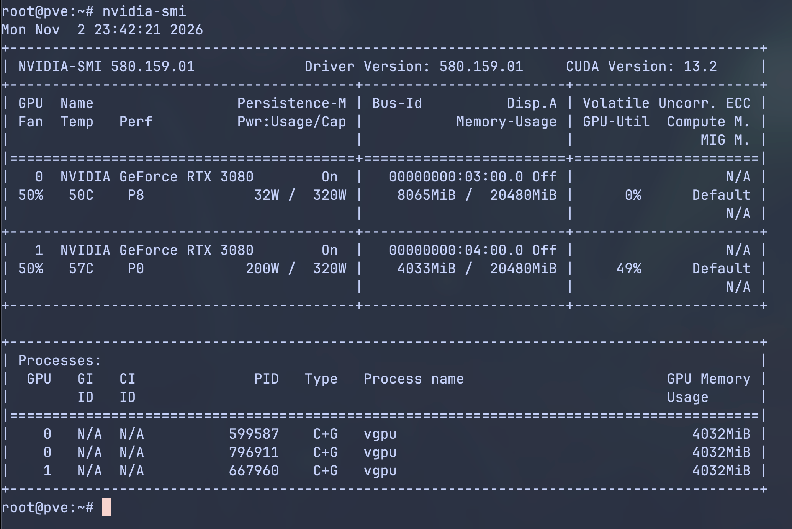
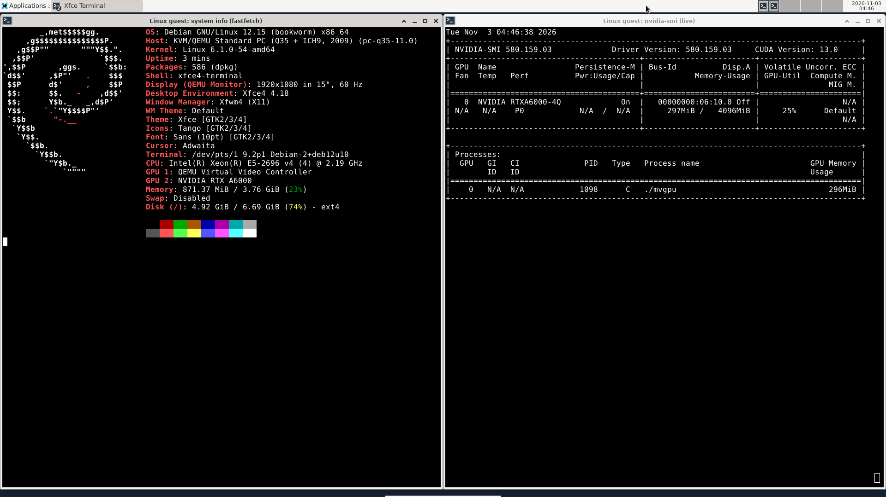
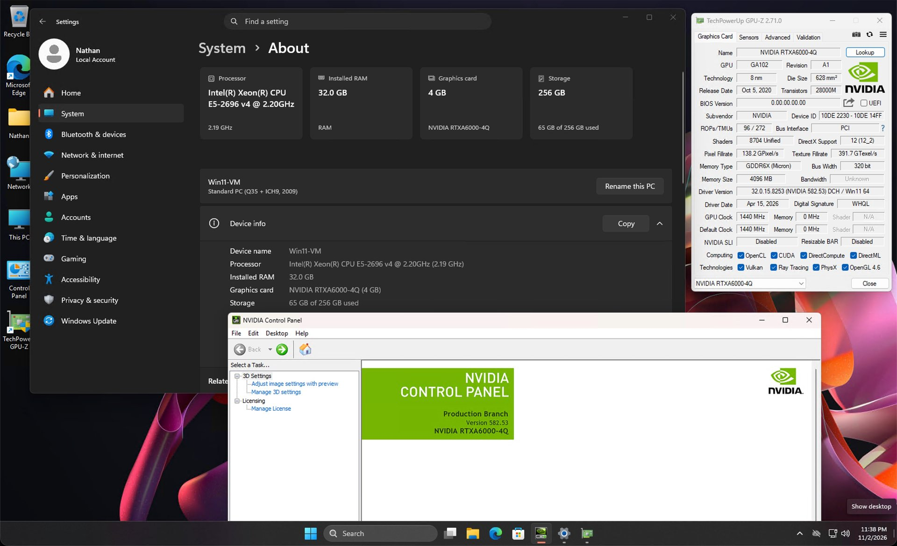
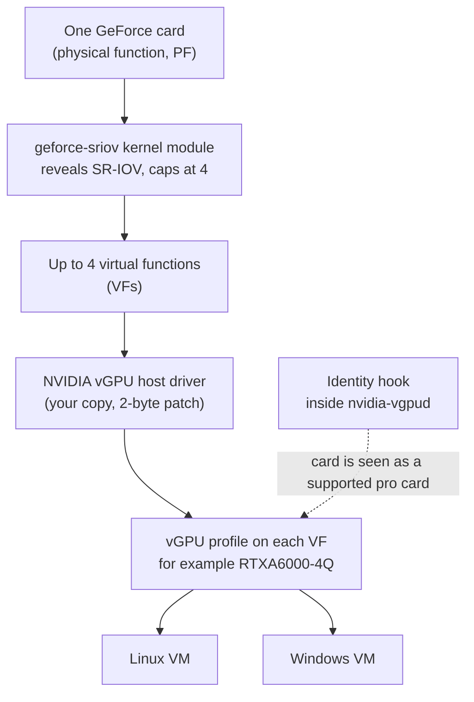
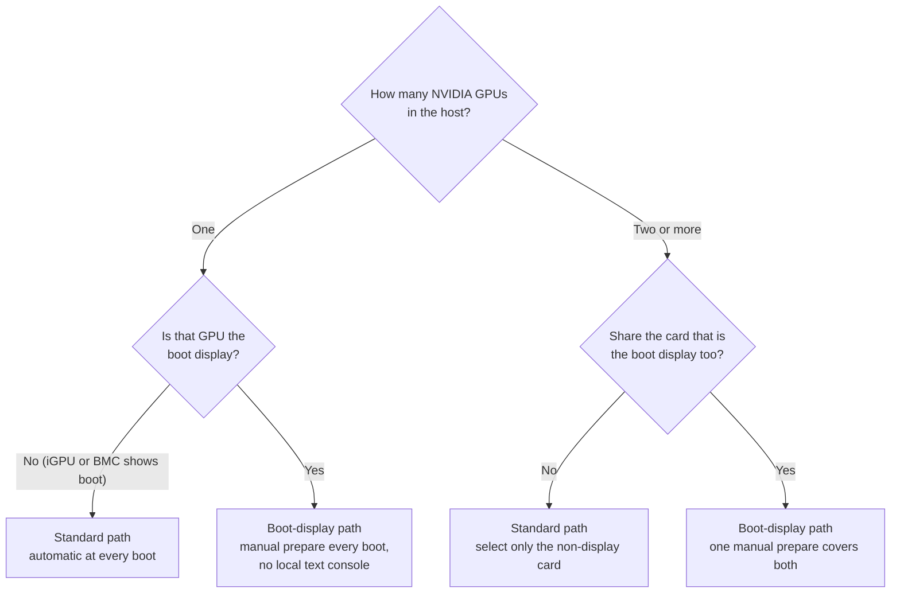

# geforce-sriov

Share one NVIDIA GeForce card between several virtual machines using NVIDIA's own vGPU software.
Each VM gets its own SR-IOV virtual function of the card.

## Disclaimer

Use at your own risk. This project is provided as is, without warranty of any kind, under the MIT
licence (the kernel module under GPL-2.0-only OR MIT; see [LICENSE](LICENSE)). I am not responsible
or liable for any damage, data loss, hardware failure, instability, downtime or voided warranty
that results from using it.

Blackwell GPUs are not expected to work with the current implementation. Ada GPUs need a modified
NVIDIA host stack that this package does not fully provide; one RTX 4070 SUPER ran vGPU guests
with it, set up by hand ([Ada host stack](docs/ada.md)). `geforce-sriov-patch` now makes both
measured revisions of the host kernel object and the plugin revision, on copies of your files;
building and installing the module remain your step. References to Ada and Blackwell in these
docs are for experiments only.

> [!NOTE]
> **Status: experimental.** geforce-sriov has been measured on one host with two memory-modded
> RTX 3080 20GB cards and one NVIDIA driver version. Everything else is unverified. See
> [What has been verified](#what-has-been-verified) before you start.

Whether it works or not on your hardware, please submit a [compatibility report](https://github.com/noon-at-cgn/geforce-sriov/issues/new?template=compatibility-report.yml).

## Showcase

<table>
  <tr>
    <td width="33%"><a href="docs/images/proxmox-host.png"></a></td>
    <td width="33%"><a href="docs/images/debian-guest.png"></a></td>
    <td width="33%"><a href="docs/images/windows11-guest.jpg"></a></td>
  </tr>
  <tr>
    <td>pve host: two GeForce RTX 3080 cards running vGPUs</td>
    <td>Debian 12 guest with the vGPU: specs and nvidia-smi</td>
    <td>Windows 11 guest: NVIDIA Control Panel and GPU-Z on the vGPU</td>
  </tr>
</table>

| Benchmark | Host (LXC, physical GPU) | VM (vGPU) | VM / host |
|---|---|---|---|
| FP32 matmul (TFLOPS) | 20.47 | 20.54 | 1.003 |
| FP16 matmul, tensor cores (TFLOPS) | 58.35 | 58.54 | 1.003 |
| Device memory copy (GB/s) | 681.7 | 704.4 | 1.033 |

Same PyTorch benchmark on one memory-modded RTX 3080 20GB, same pinned CPU cores and memory,
nothing else on the card; median of 3 runs. The host side runs CUDA on the physical GPU next to
the vGPU host driver, an experimental setup outside geforce-sriov; a 4 GiB vGPU in a VM performed
within 1% on matmul.

More on the [Showcase page](docs/showcase.md), including
[how this was measured](docs/showcase.md#performance-vgpu-vm-vs-host).

## What you need

- NVIDIA's vGPU host driver package for Linux KVM, which **you obtain yourself** from NVIDIA with
  your own entitlement. vGPU Software 19.5 with host driver **580.159.01** is recommended and
  verified to work. Other versions may work but have not been tested. The matching guest drivers
  are taken from the same release. geforce-sriov does not include, download or provide any of
  them.
- A card from the device table. Only Ampere is confirmed to work: the memory-modded RTX 3080 20GB
  (`10de:2206`, subsystem `10de:146d`) is the one card measured with this package, and every other
  listed card is experimental ([docs/devices.md](docs/devices.md)). Blackwell needs NVIDIA's GSP
  firmware and open flavour, which this package does not support. Ada needs your own modified
  580.159.01 host stack with GSP off, measured by hand on one RTX 4070 SUPER
  ([Ada host stack](docs/ada.md)).
- A Linux host (x86_64, kernel 6.8 or later with livepatch support), kernel headers, DKMS, a C
  compiler, `make` and `pciutils`. The IOMMU must be on.
- A valid NVIDIA vGPU licence setup of your own for the guests. geforce-sriov does not provide
  licensing.
- (optional) A way back in: SSH, a way to cold power-cycle the machine (IPMI, a smart plug, or a
  hand on the power button), and netconsole or a serial console if available.

The full list with check commands is in the
[prerequisites checklist](docs/installation.md#1-prerequisites-checklist).

## Quick start

For one GPU that is **not** the boot display, after the
[prerequisites](docs/installation.md#1-prerequisites-checklist) (including NVIDIA's
[vGPU daemon units](docs/installation.md#nvidias-vgpu-daemon-units)) and the
[driver patch](docs/driver-patch.md). NVIDIA's vGPU host driver must already be installed from your
own package, and the guests need your own vGPU licence setup; geforce-sriov provides neither.
Replace `0000:03:00.0` with your card's address.

```sh
make && make check
./geforce-sriov doctor --device 0000:03:00.0
sudo ./geforce-sriov install --device 0000:03:00.0
sudo geforce-sriov doctor                                # then power off, power on
sudo geforce-sriov status && sudo geforce-sriov enable
sudo systemctl restart nvidia-vgpud.service && sudo systemctl restart nvidia-vgpu-mgr.service
```

Then give a VM one vGPU ([Create a VM](docs/installation.md#8-create-a-vm)). Each step, with the
output to expect, is explained in the [installation guide](docs/installation.md).

**Ada (experimental, not hardware-tested as packaged):** with your own modified host stack in
place, replace the last line by `sudo geforce-sriov activate`, and run `geforce-sriov check` before
every VM start ([Ada host stack](docs/ada.md)). The Proxmox `mdev=` route of Create a VM has not
been tried on Ada ([On the VM side](docs/ada.md#on-the-vm-side)).

**Why not the boot display?** NVIDIA's
[vGPU documentation](https://docs.nvidia.com/vgpu/19.0/grid-vgpu-user-guide/grid-vgpu-introduction.html#primary-display-adapter-requirements)
states that the GPU set as the primary display adapter cannot be used for vGPU. So by default
geforce-sriov refuses a card that shows the boot screen and console (`boot_vga` is `1`), unless
you opt in with `--boot-display-release` ([The boot display GPU](docs/boot-display.md)).

**Several GPUs:** give one `--device` per card, up to 8 cards. Two cards, neither the boot display:

```sh
./geforce-sriov doctor --device 0000:03:00.0 --device 0000:04:00.0
sudo ./geforce-sriov install --device 0000:03:00.0 --device 0000:04:00.0
```

**A normal card plus the boot display card** (here `0000:04:00.0`): name the display card in
`--boot-display-release` and also as a `--device`. The boot unit then prepares none of the cards.
Keep `nvidia` from loading at boot ([details](docs/boot-display.md#setting-it-up)), and after
each boot prepare all cards with one manual command:

```sh
sudo ./geforce-sriov install --device 0000:03:00.0 --device 0000:04:00.0 --boot-display-release 0000:04:00.0
# after each boot, over SSH, as root:
geforce-sriov prepare --release-console=0000:04:00.0
modprobe --ignore-install nvidia
```

Then continue with `enable` and the two daemons as above.

## How it works



geforce-sriov is a small set of Linux host tools. It makes the kernel see SR-IOV, which the
consumer GeForce card hides, splits the card into at most four virtual functions, and lets
NVIDIA's vGPU host software accept the card. Each virtual function can then back one vGPU in a VM,
for example on Proxmox VE. This is the SR-IOV method, not the legacy mdev method (see below).

| Part | What it does for you |
|---|---|
| Kernel module `geforce_sriov` (DKMS) | Makes the kernel see the card's hidden SR-IOV feature, only on the cards you list, and caps it at 4 virtual functions |
| Boot unit `geforce-sriov-prepare.service` | Prepares those cards once per boot, before NVIDIA's driver touches them |
| CLI `geforce-sriov` | Checks the host (`doctor`, `status`), installs everything, and enables the virtual functions (`enable`) |
| Identity hook `libgeforce_sriov.so` | Lets NVIDIA's `nvidia-vgpud` daemon accept the GeForce card as its professional counterpart, so it offers vGPU types |
| Driver patcher `geforce-sriov-patch` | Makes a two-byte fix to **your own copy** of NVIDIA's driver object so guest GPU work does not stall; its `ada list`, `ada inspect`, `ada apply` and `ada revert` commands make the Ada revisions on copies ([Ada revisions](docs/driver-patch.md#ada-revisions)) |

geforce-sriov is **not** a vBIOS flasher, not a licensing tool and not a security boundary between
guests. It ships no NVIDIA software and never edits NVIDIA's `vgpuConfig.xml`. Each part is
explained step by step, with the technical details (exact capability offsets, VF layout checks,
hook attribution, PCI topologies), in
[docs/technical-reference.md](docs/technical-reference.md#how-it-works-step-by-step). The sequence
from install to a running VM is diagrammed in
[docs/installation.md](docs/installation.md#what-happens-from-install-to-a-running-vm).

**ARI and the VF count.** The VF count is a normal SR-IOV setting: `install --vfs N` (or `vfs=N` in
the [configuration file](docs/configuration.md#configuration-file)) chooses it, from 1 up to the
card's hardware default, and `enable` enables every VF the card presents. The default is 4. The
reason is ARI: it is enabled in software (the module presents the card's ARI capability and turns on
ARI forwarding in the bridge directly above the card, on the measured host a CPU root port), but ARI
decoding in the GPU hardware does not work for now. The default may change if ARI decoding is made
to work. On Ada and Blackwell the default is the card's own count, 1
([details](docs/devices.md#ada-and-blackwell)).

**SR-IOV virtual functions, not the legacy mdev split.** NVIDIA's documentation distinguishes two
kinds of vGPU on Linux KVM
([NVIDIA vGPU user guide](https://docs.nvidia.com/vgpu/19.0/grid-vgpu-user-guide/installing-configuring-grid-vgpu.html#creating-vgpu-device-red-hat-el-kvm)).
A legacy vGPU, on a GPU without SR-IOV, is created as a mediated device (mdev) on the GPU's one
physical function, which the host driver splits between the VMs. A vGPU on a GPU with SR-IOV
(Ampere and later) resides on one of the GPU's virtual functions instead. geforce-sriov uses the
SR-IOV method: the card exposes real SR-IOV VFs, each VF is given to one VM, and the vGPU type is
selected on that VF (in the measured setup the VF's `nvidia/current_vgpu_type` file shows it).
Proxmox VE still names the type with an `mdev=` option on the VF
([Proxmox VE wiki](https://pve.proxmox.com/wiki/NVIDIA_vGPU_on_Proxmox_VE)), for example
`hostpci0: 0000:03:00.4,mdev=nvidia-527` ([Create a VM](docs/installation.md#8-create-a-vm)).

> [!IMPORTANT]
> vGPU types come unchanged from the professional card's list and are **not** filtered by your
> card's memory. An RTX A6000 has 48 GB, an RTX 3080 20GB has 20 GB. Choose types so that all
> running vGPUs together fit: four `4Q` vGPUs (4 GB each, 16 GB total) fit a 20 GB card; four
> `8Q` vGPUs do not.

## Which path do I need?

The card that shows the firmware boot screen and the Linux text console is the *boot display*.
Check a card with `cat /sys/bus/pci/devices/0000:03:00.0/boot_vga` (`1` means boot display).
On a server whose board has its own BMC graphics, the GPU is usually not the boot display.



- **Standard path:** follow the [installation guide](docs/installation.md). The boot unit prepares
  the cards automatically.
- **Boot-display path:** follow the installation guide, but install with `--boot-display-release`
  and read [The boot display GPU](docs/boot-display.md) first. With this grant the boot unit
  prepares **none** of the selected cards; you prepare all of them by hand after each boot.
- **Tip:** the simplest way to avoid the boot-display path is an integrated GPU or a cheap second
  graphics card for the local console.

## What has been verified

Everything below was measured on **one host**. Nothing beyond it is claimed.

| Item | Measured setup |
|---|---|
| Cards | Two memory-modded RTX 3080 20GB, PCI ID `10de:2206`, subsystem `10de:146d` |
| Host platform | Xeon E5 v4 host with Windows 11 26H2 guests |
| Host kernel | `7.0.14-16-pve` (Proxmox VE) |
| NVIDIA vGPU host driver | 580.159.01, with `nvidia.ko` rebuilt from `geforce-sriov-patch` output |
| Switches | `ari=on`, `msix=on` (the defaults). ARI was enabled in software; ARI decoding in the GPU hardware does not work for now |
| Preparation | geforce-sriov prepared both cards. The non-display card was prepared automatically at a cold boot; the boot-display card was prepared with the manual console-release path |
| Identity hook | The package's hook ran in `nvidia-vgpud` through the drop-in and presented both cards as `10de:2230` (RTX A6000) with 23 vGPU types each |
| Virtual functions | 4 per card (the default count, see [How it works](#how-it-works)), enabled with `geforce-sriov enable` |
| Guests | 8 at once: per card 2 Linux and 2 Windows 11, each with a 4 GiB `RTXA6000-4Q` vGPU |
| Workload | One 30-minute run of concurrent CUDA (Linux) and D3D11 (Windows) work; the test harness recorded no failures |
| Restarts | One Linux guest and one Windows guest were restarted while the other guests kept running |

**Does it work on your machine?** Other hardware has not been measured with this package. A
separate, by-hand Ada measurement on one RTX 4070 SUPER, with a host stack this package does not
fully provide, is described in [Ada host stack](docs/ada.md). What to collect, what to remove
before posting and what happens to a report is in
[docs/compatibility.md](docs/compatibility.md); reports from others are listed under the
[`compatibility` label](https://github.com/noon-at-cgn/geforce-sriov/issues?q=label%3Acompatibility).

## Documentation

| Page | What it covers |
|---|---|
| [Installation](docs/installation.md) | Prerequisites with check commands, then every step from build to a VM, with the expected output; uninstall |
| [The boot display GPU](docs/boot-display.md) | Sharing the card that shows the boot screen: why it is refused by default, the opt-in, the manual prepare after each boot |
| [Configuration and commands](docs/configuration.md) | Config file keys (`vfs`, `ari`, `msix`, …), commands and exit codes, systemd units, module parameters |
| [Troubleshooting](docs/troubleshooting.md) | Symptoms and fixes, messages that look like errors but are expected, where the logs are |
| [Recovery](docs/recovery.md) | The one rule, the guard, switches to turn features off, uninstall details, what not to do |
| [Glossary](docs/glossary.md) | PF, VF, BDF, SR-IOV, ARI, MSI-X, mdev and the other terms used here |
| [Manual method](docs/manual-method.md) | Everything the CLI does, by hand, with the exact sysfs paths the code uses; the best way to understand the tool. Use the CLI for normal operation: by hand you have none of its checks |
| [Technical reference](docs/technical-reference.md) | How each part works, kernel module, identity hook, PCI topologies, full command and config rules |
| [Driver patch](docs/driver-patch.md) | Patching and rebuilding NVIDIA's module, and re-applying it after updates |
| [Devices](docs/devices.md) | The device table and the status of each card |
| [Ada host stack](docs/ada.md) | Ada: the by-hand RTX 4070 SUPER measurement, what you must provide, `activate` and `check`, recovery |
| [Compatibility reports](docs/compatibility.md) | Reporting whether geforce-sriov works on your hardware: what to collect, what to remove, what happens to a report |
| [Identity hook](hook/README.md) | Identity hook internals |
| [Showcase](docs/showcase.md) | Screenshots of the measured host and of a Linux and a Windows guest using a vGPU; vGPU vs host performance |
| [Changelog](CHANGELOG.md) | Release notes |

## Related projects

geforce-sriov uses SR-IOV virtual functions instead of mdev (mediated devices), and targets Ampere
and newer cards. Only Ampere is confirmed to work with this package. Ada and Blackwell are
experimental only ([Ada host stack](docs/ada.md)). Other projects with similar goals, and what each
one reports:

- [polloloco/vgpu-proxmox](https://gitlab.com/polloloco/vgpu-proxmox): an install guide and driver
  patches for NVIDIA vGPU on Proxmox VE, using mdev. It covers consumer Maxwell 2.0 (except the
  GTX 970), Pascal and Turing cards and says RTX 30xx and 40xx cards will not work. Use it for
  Turing and older cards, which geforce-sriov does not cover.
- [DualCoder/vgpu_unlock](https://github.com/DualCoder/vgpu_unlock) and
  [mbilker/vgpu_unlock-rs](https://github.com/mbilker/vgpu_unlock-rs): the original vGPU unlock for
  consumer cards, which presents a GeForce card to NVIDIA's vGPU software as a supported professional
  model. Maxwell to Turing, mdev. The identity hook in geforce-sriov follows the same idea.
- [Nium32/VGPU-MDEV-RTX-3090](https://github.com/Nium32/VGPU-MDEV-RTX-3090): NVIDIA vGPU on a
  GeForce RTX 3090 through the legacy mdev path, with driver 535.309.01 on Linux 6.1 or 6.5. It
  documents a scheduler fix and a list of approaches that failed. Same chip family as the tested
  card here, with a different mechanism.
- [olealgoritme/blackwell-vgpu-unlock](https://github.com/olealgoritme/blackwell-vgpu-unlock):
  patches and scripts for one SR-IOV vGPU on a GeForce RTX 5090 with driver 580.159.01. Its README
  reports compute in a Linux guest and lists graphics, Windows guests and more than one VF as not
  working. Not verified by geforce-sriov.
- [bird/vgpu-unlock-blackwell](https://github.com/bird/vgpu-unlock-blackwell): a write-up of an
  RTX 5090 attempt on driver 595.58.03. It reports that the host-side steps work and that the GPU
  firmware then stops on registers that are missing on consumer silicon. Not verified by
  geforce-sriov.

How these two reports relate to geforce-sriov is described in
[docs/devices.md](docs/devices.md#third-party-reports).

## License

MIT ([LICENSE](LICENSE)), except the kernel module and its shared device table
(`kernel/`, `include/gs_devices.h`), which are `GPL-2.0-only OR MIT`
([LICENSES/](LICENSES/)). Third-party notices (NVIDIA open-gpu-kernel-modules headers,
`vgpu_unlock-rs`, `vgpu_unlock`) are in [NOTICE](NOTICE). NVIDIA and GeForce are trademarks of
NVIDIA Corporation; this project is not affiliated with NVIDIA.
