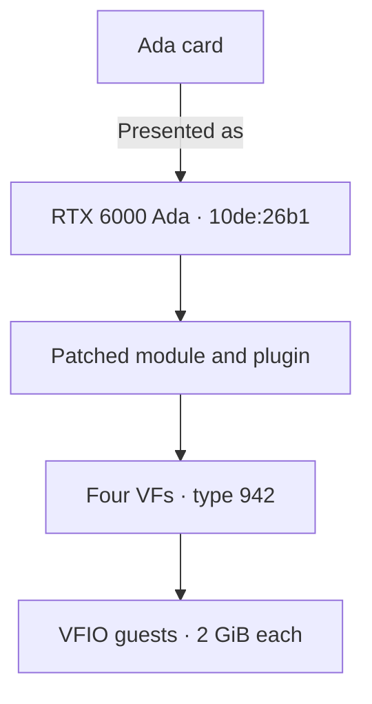
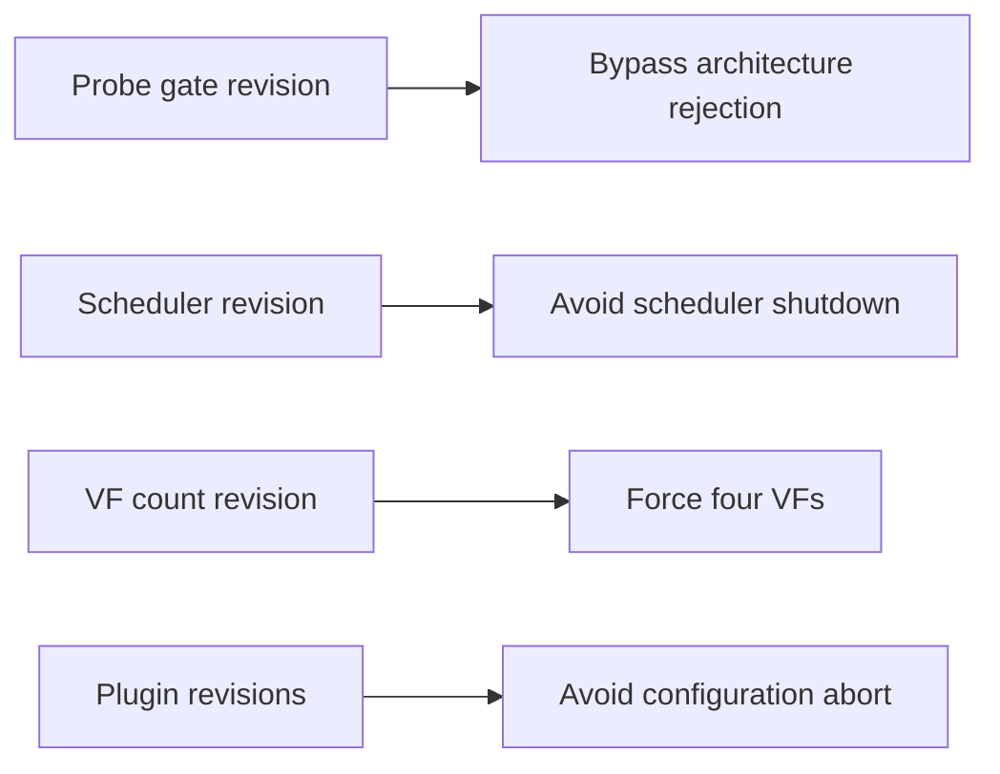
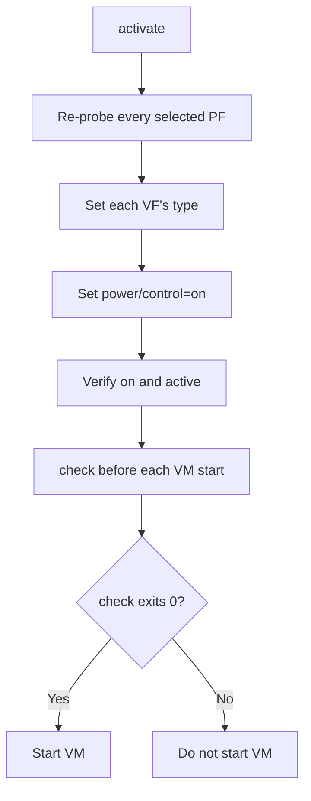
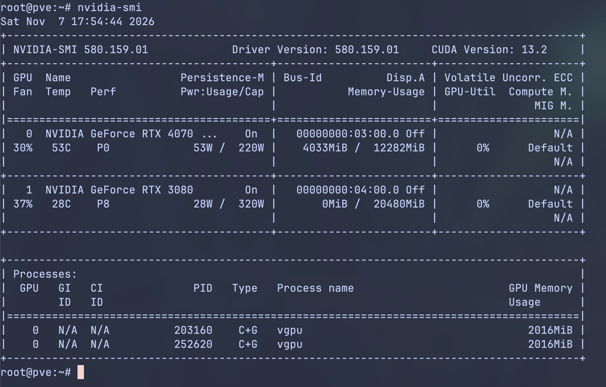
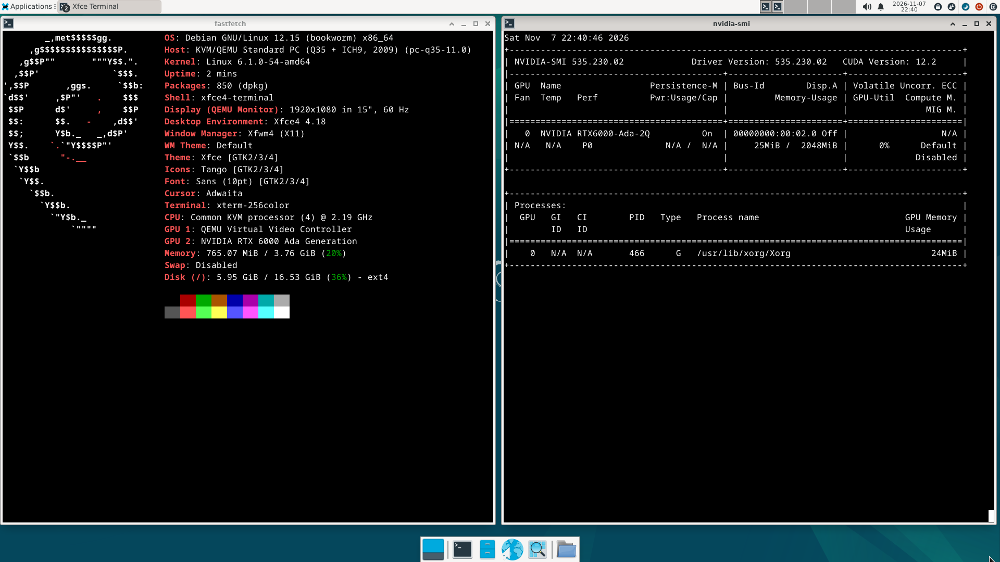
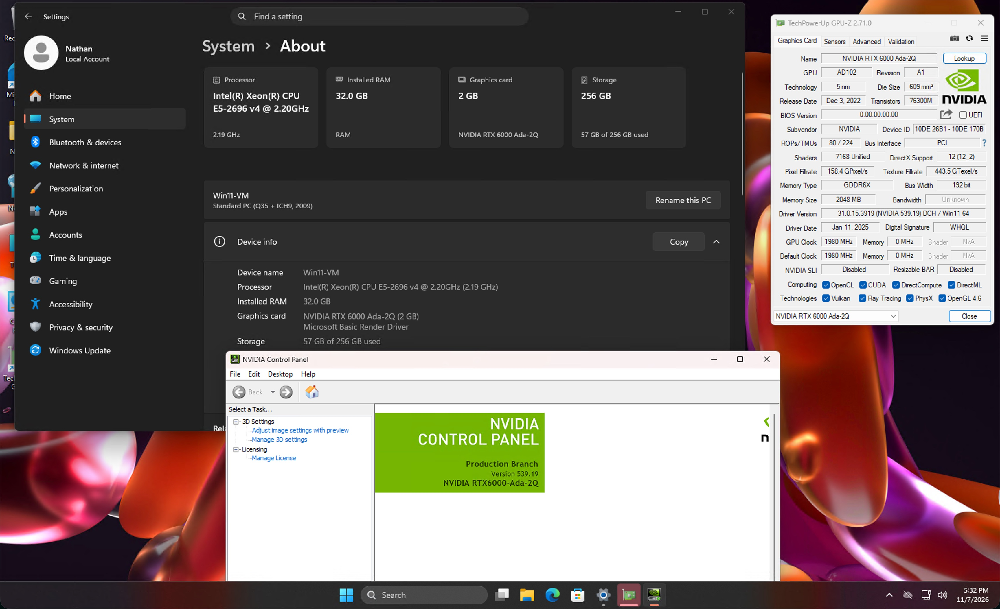

# Ada support

## At a glance

| Item | Value |
|---|---|
| Device IDs | Every Ada row in [devices.md](devices.md#rows). Tested card: `10de:2783` (RTX 4070 SUPER, AD104) |
| Laptop GPUs | Supported through the same path as the desktop cards ([Laptop support](laptops.md)). No laptop GPU has been tested |
| Presented as | RTX 6000 Ada, `10de:26b1` |
| VFs per card | 4 |
| Host driver | NVIDIA vGPU software 19.5, host driver 580.159.01, vGPU-KVM proprietary build, CPU-side mode with `NVreg_EnableGpuFirmware=0`, GSP not used |
| vGPU plugin | The patched plugin copy this package makes from the 580.159.01 stock plugin (SHA-256 `aa4fdeb5…`) |
| Host module | `nvidia.ko` built from the 580.159.01 object with the three revisions |
| Linux guest | 535.230.02 (vGPU 16.9) |
| Windows guest | 539.19 (vGPU 16.9) |
| Guest setting | `RMSetVgpuGspPluginOffloadMode=0` |
| Default vGPU type | 942, RTX6000-Ada-2Q, 2048 MiB |
| Status | supported |

## How it works

- NVIDIA's vGPU stack does not list the GeForce and some workstation cards.
  The package reveals the card's hidden SR-IOV virtual functions (VFs) and presents it to that stack as an RTX 6000 Ada, regardless of its model.
- The stock proprietary module refuses Ada on a vGPU host: `rm_is_supported_device` returns `NV_ERR_NOT_SUPPORTED` (`0x56`) for an architecture above `0x17`, and Ada is `0x19`.
  The probe gate revision replaces a two-byte conditional jump in that check with two NOPs.
  With GSP off, the driver then runs on the CPU.
- The scheduler revision is the same two-byte change Ampere uses.
  Without it, a PMU-service callback disables the GPU's runlist scheduler and guest work stalls.
- The RM reads an Ada card's VF total from the hardware and accepts vGPUs only up to that count.
  Every Ada row with a public dump reports 1, except `28b0`, which reports 16.
  The VF count revision replaces a 16-bit load inside `kbifCacheVFInfo` with the constant 4.
- Without the plugin revision, the stock plugin makes `nvidia-vgpu-mgr` abort the vGPU configuration (`0x1f`) on Ada, and the instance does not start.

With the default profile:



### With the other generation

A host can hold Ada and Ampere cards together.
Select each card with its own `--device`; no other setting is needed.
See [Ampere](ampere.md#with-the-other-generation) for the Ampere side.

- One module and one plugin serve both generations, alone or together, with the same bring-up procedure.
  Both use the patched plugin copy.
  On 580.159.01, `activate` refuses any other plugin: the stock one, the earlier Ada-only copy and an earlier copy with only the placement change.
  On another host driver version, which is not supported, it warns and continues.
- The module forces four VFs on every card bound to it, so an Ampere card beside an Ada card presents four VFs too.
- Each generation has its own type: `type_ada` and `type_ampere` in the config, by default 942 on Ada and 525 on Ampere.
- `--type` is refused on a mixed selection ([commands](configuration.md#commands)).
  Set the two config keys instead, or narrow `check` to one generation with `--device`.
- `doctor` warns when a selection mixes Ada with another generation.
  Apart from `--type`, nothing refuses a mixed host.
- The recovery rule is host-wide: if any card disappears from `lspci` or the host cannot be reached, cold power cycle the whole machine ([the one rule](recovery.md#the-one-rule)).

### Choosing a profile

A vGPU type, also called a profile, sets how much of the card's memory each vGPU gets.
The card offers the RTX 6000 Ada types.
Its Q types are 941 (1Q), 942 (2Q), 943 (3Q), 944 (4Q), 945 (6Q), 946 (8Q), 947 (12Q), 948 (16Q), 949 (24Q) and 950 (48Q); NVS-class types are offered too.
The number before Q is the profile size in GiB, and the list is not filtered by the card's memory.
Set the type with `type_ada=` in the config; every VF of the card gets it ([Choosing a vGPU type](configuration.md#choosing-a-vgpu-type)).

> [!IMPORTANT]
> Choose vGPU profiles that fit your card's physical VRAM.
> All the vGPUs you run at once must fit in the VRAM together, with some room left over because the host driver uses part of the memory too.
> For example, four `4Q` vGPUs (16 GB in total) fit a 20 GB card, and four `8Q` vGPUs (32 GB) do not.

Each VF has a fixed framebuffer slot, and a later VF's slot ends higher in the card's memory.
With a large type, the last VFs may not start a VM, so put VMs on the lower VFs.
`activate` names the VFs whose slot ends near the top of the card's memory.
That line is a hint, not a limit.

## Host stack

`install` applies the NVIDIA changes to copies of your own files:

- It applies the three module revisions in the order below to a copy of your own `nv-kernel.o_binary`, then rebuilds and installs `nvidia.ko`.
- It applies the two plugin revisions to a copy of your own `libnvidia-vgpu.so` and points the symlink at it.
- It writes the GSP-off module option.

It accepts only the 580.159.01 files whose SHA-256 it has recorded and checks the result of each step against the recorded digest.
It refuses any other file.
After the build, `install` requires the `.text` of the built module to differ from the stock one at exactly the eight recorded offsets; otherwise it refuses the module ([Compare with a stock build](driver-patch.md#compare-with-a-stock-build)).
The offsets, bytes and commands are on one page:

1. Scheduler ([revisions](driver-patch.md#revisions))
2. Probe gate ([revisions](driver-patch.md#revisions))
3. VF count ([revisions](driver-patch.md#revisions))
4. Plugin, placement change ([revisions](driver-patch.md#revisions))
5. Plugin, framebuffer change ([revisions](driver-patch.md#revisions))

With `install --driver=skip`, you must perform the same steps yourself ([The manual path](driver-patch.md#the-manual-path)).
`activate` checks that the symlink resolves to the patched plugin copy.

- Module option: `options nvidia NVreg_EnableGpuFirmware=0`, which `install` writes to `/etc/modprobe.d/` unless a file there already sets it to 0.
  `nvidia-smi -q` then shows `GSP Firmware Version: N/A`.
- NVIDIA's open flavour always uses GSP and is not supported on Ada.
- The host and guest drivers must match the [supported software stack](installation.md#supported-software-stack).
  `install` accepts only host driver 580.159.01 and refuses any other version.
  Other guest driver versions are not supported.
  On the manual path (`--driver=skip`), other host driver versions are not supported either: `doctor`, `check` and `activate` warn and continue.
- To have `install` take NVIDIA's `.run` package as well, see `--driver-file`,
  `--accept-nvidia-license` and `--nvidia-source` in
  [One command from a clean host](installation.md#one-command-from-a-clean-host).

Until both the module and the plugin copy are in place, `activate` refuses on 580.159.01 and the Ada stack cannot be completed.
On another host driver version, which is not supported, it warns and continues.

Each change addresses a different host-side restriction:



## Bring-up differences

Ada follows [Cold boot](installation.md#cold-boot): the activate unit runs `activate --boot` at boot, and `check` gates every VM start.
Without the unit, run `activate` yourself.
Where the config grants a console release, the unit does not run, and `setup` asks before it releases the console and brings the cards up ([Boot display card](installation.md#boot-display-card)).

```sh
sudo geforce-sriov activate --dry-run         # preflight checks only, then prints the steps; changes nothing
sudo geforce-sriov activate                   # after a boot where the activate unit did not run
geforce-sriov check                           # before every VM start
```

Exit codes and `--type` are in [commands](configuration.md#commands).

- `activate` creates the VFs if they are missing, loads `nvidia_vgpu_vfio`, restarts `nvidia-vgpud` and `nvidia-vgpu-mgr` in order, re-probes each selected PF, sets the vGPU type on every VF, powers each VF on and reads the result back.
  Restart those daemons through `activate` only.
- A card takes one vGPU size at a time.
  On the tested card, with VFs `.4`, `.6` and `.7` at type 942 (2048 MiB) and `.5` cleared to 0, writing type 944 (4096 MiB) to `.5` failed with EIO, and `creatable_vgpu_types` on `.5` listed only the 2048 MiB types.
  `activate` sets the same type on every VF of a card.
- `nvidia_vgpu_vfio` keeps the vGPU type table of a card's first registration after a boot.
  After an earlier build changed the Ada target to the L4 on a running host, `activate` refused that target's type (`type 911 is not in nvidia/creatable_vgpu_types`) until the next cold boot ([Symptoms](recovery.md#symptoms)).
- Both commands act on every selected Ada or Ampere card.
  They refuse without changing anything when a card in scope is not in the device table (a Blackwell card, for example).
  The daemon restart is host-wide, so `activate` also refuses while a GPU not selected in `bdfs` has VFs enabled.
- `activate` writes `/run/geforce-sriov/activating` before its first change and removes it once every VF reads back `on` and `active`.
  `check` reports `NOT READY` while the file exists.
  Exit 5 leaves the guard set and requires a cold power cycle first ([the one rule](recovery.md#the-one-rule)).
- Run `activate` only while no VM start is pending, for example before the VMs autostart.
  Restarting `nvidia-vgpu-mgr` ends any vGPU on the host.
- `activate` needs NVIDIA's driver to grant `unbindLock`.
  A client such as `nvidia-smi`, `nvidia-persistenced` or a CUDA program that holds the GPU makes it stop with exit 1.

### The VF power gate

Every VF needs `power/control=on` and `runtime_status=active` after the last PF re-probe, and `activate` sets and verifies both.
With `auto`, a VF suspends between attaches and the next guest start fails with `RmInitAdapter failed! (0x11:0x45)` (`NV_ERR_IRQ_NOT_FIRING`).
On the tested card, `auto` failed 8 of 8 re-attaches and `on` passed every one.

A `nvidia-vgpu-mgr` restart or a PF re-probe on any card can put VFs back to `auto`.
After either, stop the VMs that use a vGPU on any card of the host, set their VFs' type back to `0`, and run `activate` again.
A udev rule or a systemd `ExecStartPost` that writes `on` is no replacement.

The power settings must be applied after the last PF re-probe:



### The `check` gate

`geforce-sriov check [--device BDF]... [--type N]` changes nothing and needs no root.
It prints one line per VF:

```text
OK <VF> (VF of <PF>): driver=nvidia type=942 expected=942 power/control=on runtime_status=active
```

It prints `NOT READY` and exits 1 when `/run/geforce-sriov/activating` exists, when the guard `/var/lib/geforce-sriov/prepare-attempt` is set, when it cannot tell whether either file exists, or when a VF or PF is not ready.
Start no VM on a VF marked `NOT READY`.

`check` is a point-in-time read and takes no lock, so run it right before the VM start.
A matching type shows that the types were registered, not that `activate` ran in this boot.

## Guests and VMs

The package installs nothing in a guest.
The steps shared by every card are in [Guests](installation.md#guests).
The 16.9 drivers below come from an older vGPU release than the host driver.
They are the drivers that ran on the tested card, and the 16.9 branch is outside NVIDIA's supported matrix for this host.

| Guest | Driver | Required guest setting |
|---|---|---|
| Linux | 535.230.02 (vGPU 16.9) | `options nvidia NVreg_RegistryDwords="RMSetVgpuGspPluginOffloadMode=0"` in `/etc/modprobe.d/`. Without it the guest driver loops `RmInitAdapter failed! (0x22:0x65:897)` |
| Windows | 539.19 (vGPU 16.9) | DWORD `RMSetVgpuGspPluginOffloadMode` = `0` in the adapter's class key and in `HKLM\SYSTEM\CurrentControlSet\Services\nvlddmkm`. Without it the device shows Code 43 |

Each VF is passed to QEMU as a plain VFIO device, with the vGPU type already set on the VF and no mdev ([Create a VM](installation.md#create-a-vm)).
The argument is the same on every host.
On Proxmox VE, the host of the tested card, it goes in a raw `args` line rather than `hostpci…,mdev=`:

```text
args: -device vfio-pci,host=<VF>,enable-migration=off
```

Give every VFIO device `enable-migration=off`.
Without it, a plain VM stop makes `nvidia-vgpu-vfio` return an error to QEMU's migration handshake and QEMU resets the device.
The stop completes either way, but the option avoids those messages.
You must handle licensing separately.

## Screenshots

<a href="images/ada/proxmox-host.png"></a>

The Proxmox VE host runs driver 580.159.01.
`nvidia-smi` shows two vGPU processes on the Ada card, each using 2016 MiB.

<a href="images/ada/debian-guest.png"></a>

The Debian 12 guest shows `NVIDIA RTX6000-Ada-2Q` with 2048 MiB and guest driver 535.230.02.

<a href="images/ada/windows11-guest.jpeg"></a>

The Windows 11 guest shows `NVIDIA RTX 6000 Ada-2Q` with 2 GB.
NVIDIA Control Panel and GPU-Z report guest driver 539.19.

## Known limits

- `vfs` accepts values from 1 to the card's ceiling (16 on Ampere and `28b0`, 4 on other Ada cards); NVIDIA's patched driver uses at most 4 VFs per card.
  The VFs take functions 4 to 7 of the card's slot, and ARI decoding in the GPU beyond function 7 does not work.
- The open flavour and the GSP route are not supported.
