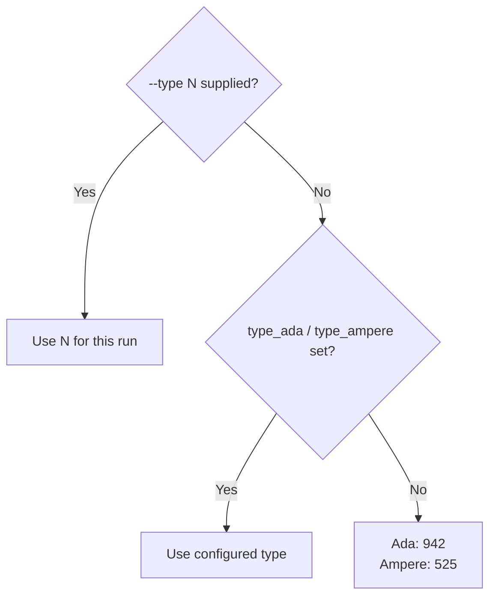
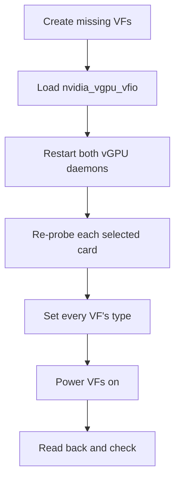
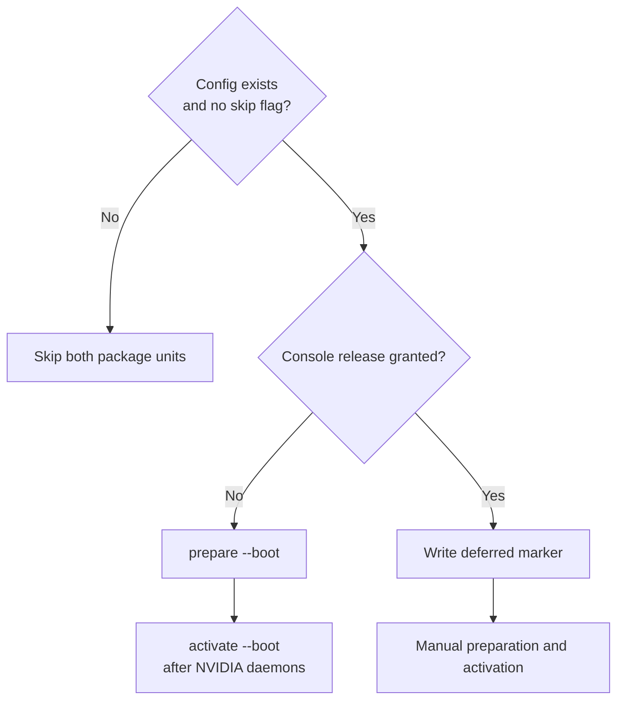

# Configuration and commands

This page covers the configuration file, commands, systemd units and kernel module parameters.
See [Configuration file](#configuration-file) for parsing and validation rules, and [Commands](#commands) for each command's complete option list.

## Configuration file

The configuration file holds your card selection, feature switches, VF count and each generation's vGPU type.
`install` writes it.

- Its path is `/etc/geforce-sriov/config`.
  `doctor`, `status`, `check`, `prepare`, `activate` and `uninstall` read the path in `$GEFORCE_SRIOV_CONFIG` instead when it is set.
  `install` always uses `/etc/geforce-sriov/config`.
  `setup` refuses a `$GEFORCE_SRIOV_CONFIG` that names an existing file other than that one.
- It holds one `key=value` per line, with `#` comments and no spaces.
- It must be owned by root and not writable by group or others.
- An annotated copy is installed as `/usr/local/share/geforce-sriov/config.example`
  ([config/config.example](../config/config.example)).

| Key | Values | Default | Meaning |
|---|---|---|---|
| `bdfs` | 1–8 card addresses, comma-separated | none | Cards that the kernel module, `prepare`, `activate` and the hook act on. The rebuilt `nvidia.ko` applies to every card bound to it, selected or not ([What install does](driver-patch.md#what-install-does)) |
| `boot_display_release` | addresses, each also in `bdfs` | none | Boot display cards whose console `prepare --release-console` may release. The boot unit then defers ([Boot display card](installation.md#boot-display-card)) |
| `ari` | `on`/`off` | `on` | Reveal the card's hidden ARI capability and turn on ARI forwarding in the bridge above it. `pci=noari` on the kernel command line forces it off. ARI decoding in the GPU hardware does not work, so `vfs` defaults to 4 either way |
| `msix` | `on`/`off` | `on` | Reveal the card's MSI-X interrupts |
| `vfs` | 1 up to the card's ceiling (below) | `4` | VFs presented per selected card. `install --vfs N` writes it |
| `identity` | `on`/`off` | `off` (`install` sets `on`) | Let the hook present the selected cards as their generation's vGPU target (RTX A6000 or RTX 6000 Ada) |
| `identity_force_host` | `on`/`off` | `off` (`install` sets `on`) | Let the hook also report vGPU host mode for the selected cards |
| `sriov_manage` | absolute path | `/usr/lib/nvidia/sriov-manage` | NVIDIA's VF tool, which `activate` runs to create the VFs of a card that has none |
| `type_ada` | vGPU type ID | `942` | The vGPU type that `activate` sets on each VF of an Ada card and that `check` expects ([Choosing a vGPU type](#choosing-a-vgpu-type)) |
| `type_ampere` | vGPU type ID | `525` | The same for an Ampere card |
| `d3cold` | `off` | none (no consent) | Records consent to keep the selected laptop GPUs powered. Without it, `prepare` refuses the run if a laptop GPU is selected. `install --disable-d3cold` writes the key; any value other than `off` is refused ([Consent](laptops.md#consent)) |

The ceiling for `vfs` is the card's hardware default, except on an Ada card that reports 1.
On those Ada cards, the VF-count revision of the host module sets the ceiling to 4.
NVIDIA's patched driver uses at most 4 VFs per card.
`doctor` shows both counts, for example "hardware default 1, geforce-sriov presents 4 (default)".

`experimental_vfs` and `twin_id` are not valid keys.
A file containing either is refused as a whole, for example with `line 5: unknown key 'twin_id'; delete this line`.

`install`, `doctor` and `prepare` refuse a `vfs` above the ceiling and warn about a value above 4.

The module's switches and VF count are fixed when it loads.
To change them, edit the file (or run `install` again), then power the machine fully off and on, as for the first prepared boot.
This requires a cold power cycle, not a reboot.

See [recovery.md](recovery.md#turn-features-off) for the switch to turn off for each symptom.

### Choosing a vGPU type

A vGPU type, also called a profile, sets how much of the card's memory each vGPU gets, for example type 527, RTXA6000-4Q, with 4096 MiB.
Each card runs one vGPU size: every VF of a card gets the same type.
`activate` and `check` use the first applicable value in this order:



The boot unit, `setup` and a plain `activate` or `check` use the file, so set the type there to keep it across boots.
`--type N` applies to one run and requires a selection of one generation.
On a mixed host, the two keys give each generation its own type.

To see the types a card offers, run `nvidia-smi vgpu -s` before a type is set, or use the lists in [Ada](ada.md#choosing-a-profile) and [Ampere](ampere.md#choosing-a-profile).
An unknown value in the file is refused with its line number, for example `line 4: type_ada must be a vGPU type ID from 1 to 999999, as nvidia/creatable_vgpu_types lists it`.

> [!IMPORTANT]
> Choose vGPU types that fit your card's physical VRAM.
> The type list comes from the professional card, so it includes types bigger than your card, and the tool does not filter them out.
> All the vGPUs you run at once must fit in the VRAM together, with some room left over because the host driver uses part of the memory too.
> For example, four `4Q` vGPUs (16 GB in total) fit a 20 GB card, and four `8Q` vGPUs (32 GB) do not.

To change a card's vGPU size:

1. Stop every VM that uses one of its VFs.
2. With `nvidia-vgpu-mgr` running, write `0` to `nvidia/current_vgpu_type` of every VF of the card.
   Never write a type while `nvidia-vgpu-mgr` is stopped.
3. Set `type_ada` or `type_ampere` in the file and run `activate`.

On an Ada card, each VF has a fixed framebuffer slot, and the slot of a later VF ends higher in the card's memory.
With a large type, the last VFs may not start a VM even when the card is otherwise empty and the type is set.
After setting the types, `activate` prints one line for such a card, for example:

```text
0000:03:00.0: with type 946 the VFs 0000:03:00.5, 0000:03:00.6 and 0000:03:00.7 may not start: their framebuffer slots end near the top of the card's 16376 MiB. Put VMs on the lower VFs, or choose a smaller type.
```

This is an advisory message: `activate` still sets the type and its exit status does not change.
The message requires NVIDIA's `/usr/share/nvidia/vgpu/vgpuConfig.xml` and `nvidia-smi`; without either, it prints nothing.
Ampere cards get no such line.

## Commands

| Command | Root | Purpose |
|---|---|---|
| [`geforce-sriov devices`](#devices) | no | Print the device table |
| [`geforce-sriov doctor`](#doctor) | no | Inspect the host without changes |
| [`geforce-sriov status`](#status) | no | Show card state and next steps |
| [`geforce-sriov setup`](#setup) | yes | Run the guided setup |
| [`geforce-sriov install`](#install) | yes | Install files and driver changes |
| [`geforce-sriov prepare`](#prepare) | yes | Prepare selected cards or clear the guard |
| [`geforce-sriov activate`](#activate) | yes | Create and configure VFs |
| [`geforce-sriov check`](#check) | no | Check readiness before VM start |
| [`geforce-sriov uninstall`](#uninstall) | yes | Remove files and restore stock files |
| [`geforce-sriov-patch`](#driver-patcher) | no | Inspect, apply or revert driver patches |

Exit codes:

- 0: ok
- 1: failed
- 2: usage error
- 3: refused (nothing changed)
- 4: another `geforce-sriov` is running
- 5: guard set (cold power cycle needed)

`install` exits 1, not 3, when it fails or refuses after it has written anything.

### devices

`geforce-sriov devices` prints the device table.

### doctor

`geforce-sriov doctor` checks the host and cards and shows what `prepare` would do.
It changes nothing.

Options:

- `--device BDF`, repeatable.
- `--boot-display-release BDF`, repeatable, each also given as `--device`: judge that boot display card with the console release `install` will grant.
- `--hold-nvidia`: assess the hold file as if `install --hold-nvidia` had written it.
  Requires a console release already granted in the config or planned with `--boot-display-release`; otherwise, `doctor` exits 2.
- `--disable-d3cold`: assess the selected laptop GPUs as if D3cold consent were recorded by `install --disable-d3cold`.
  Requires at least one laptop GPU among those assessed; otherwise, `doctor` exits 2.
- `--sysfs-root PATH`.
- `--config FILE`.
- `--nvidia-source DIR` or `--driver-file PATH`: judge the host as `install` with that option will leave it.

A host driver version other than 580.159.01 is not supported and gets a warning, not a failure.
See [What doctor checks](installation.md#what-doctor-checks) and [doctor and status](technical-reference.md#doctor-and-status).

#### Configuration and module reports

Without a config file, `doctor` reports:

- Without `--device`: `[INFO] config: /etc/geforce-sriov/config absent; defaults apply and no device is selected`.
- With `--device`: `… absent; the selected devices come from --device`.

It says whether the installed `nvidia.ko` is the driver step's build.
Before the driver step has run on the host (no record and no install manifest), it says `[INFO] the driver step has not run on this host; install runs it`.

When the installed `nvidia.ko` is the driver step's build but the loaded `nvidia` module is not, it warns:
`the running nvidia module (build-id …) is not the installed one (…); power the machine off and on to load it`.

#### Incomplete activation and service overrides

While `/run/geforce-sriov/activating` exists, it warns:
`/run/geforce-sriov/activating exists: geforce-sriov activate is running or did not finish; check reports NOT READY until activate succeeds`.

When the installed config grants no console release and a file in `/etc/modprobe.d/` still holds `nvidia` back, it warns:
`nvidia is held back at boot by <file>, and no console release is granted. activate will refuse. Remove <file> (docs/installation.md#returning-to-automatic-preparation)`.
For a file other than `nvidia-manual-load.conf`, it names the two lines to remove instead of the file.

When another drop-in of `nvidia-vgpud` or `nvidia-vgpu-mgr` sets `LD_PRELOAD`, it warns:
`<file> sets LD_PRELOAD for <unit> and overrides the geforce-sriov identity hook. Remove it or point it at <hook path>.`
The package's own `geforce-sriov.conf` is excluded.
In `nvidia-vgpud.service.d`, only a file that systemd reads after `geforce-sriov.conf` counts, because the last `LD_PRELOAD` wins.

### status

`geforce-sriov status` shows each selected card's state and next step.
It exits 0 once every selected card was prepared this boot and presents SR-IOV, and 1 otherwise; it does not check the VFs (use [`check`](#check)).

Options:

- `--device BDF`, repeatable.
- `--sysfs-root PATH`.
- `--config FILE`.

Each Ada or Ampere card's line says whether the installed `nvidia.ko` is the driver step's build.
It adds the loaded-module warning under the same conditions as [doctor](#doctor).
In that case:

- The first next step is `next: power the machine off and on (the running nvidia module is not the installed one)`.
- A prepared card without VFs gets no next step of its own.
- `status` exits 1.

While `/run/geforce-sriov/activating` exists, it prints `activate: /run/geforce-sriov/activating exists (activate is running or did not finish)` and exits 1.
Unless the loaded module is not the installed build, it also prints `` next: stop every VM that uses a vGPU, then run `geforce-sriov activate` ``.

### setup

`geforce-sriov setup` runs the guided path from a clean host to ready VFs.
It reads the host's state, runs the next steps and says when to power the machine off and on.
It creates no VM.

Options:

- `--device BDF`, repeatable.
- `--boot-display-release BDF`, repeatable.
- `--hold-nvidia`.
- `--vfs N`.
- `--driver=skip`.
- `--driver-file PATH`.
- `--accept-nvidia-license`.
- `--nvidia-source DIR`.
- `--interactive` or `--no-prompt`.

It passes options to the steps that take them.
Before the power cycle it runs `doctor` and `install`.
Afterwards it runs `doctor`, `check`, `prepare` when needed, `activate` and `check`.
See [One command from a clean host](installation.md#one-command-from-a-clean-host).

#### First install

Before a first install, `setup` asks for anything the options did not supply: NVIDIA's `.run` package, the licence and the cards.
It asks when its input is a terminal or with `--interactive`; `--no-prompt` never asks.

- With exactly one eligible card that is not the boot display, it selects that card itself.
- If the only NVIDIA card is the boot display, it asks the question below for that card. Without a terminal, or with `--no-prompt`, it refuses before installing and names `--device` and `--boot-display-release`.
- If the picked cards include the boot display, it asks `Allow releasing the console of BDF after the next boot? [y/N]`.
  Yes records the grant without releasing anything; no leaves the card out.
  After the power cycle, `setup` asks again before releasing the console.
- After the IMPORTANT notice, `setup` asks whether to create the hold file that prevents `nvidia` from loading at boot.
- If any selected GPU is a laptop GPU, `setup` shows the D3cold notice and asks whether to disable D3cold for the selected laptop GPUs; the default is no.
  Answering yes passes `--disable-d3cold` to `doctor` and `install`; declining stops `setup` with exit 3 before any step ([Consent](laptops.md#consent)).
  If `setup` cannot prompt, you must pass `--disable-d3cold`; otherwise, it stops the same way.

#### Installed host

Run the same command again after the power cycle.
On an installed host:

- First-install options (`--driver-file`, `--vfs`, `--boot-display-release`, `--hold-nvidia`, `--nvidia-source`, `--driver=skip`) print a note and are ignored.
- A `--device` selection that differs from the configured `bdfs` is refused.
- If a laptop GPU is selected and the config lacks D3cold consent, `setup` asks for it before `doctor`.
  Accepting or passing `--disable-d3cold` runs `install --driver=skip --disable-d3cold` and ends the run; declining stops `setup` with exit 3.
- If the cards are not ready and the loaded `nvidia` module is not the installed build, `setup` stops before `prepare` and `activate`.
  It exits 3, changes nothing and prints `setup: the running nvidia module is not the installed one. Power the machine off and on, then run setup again.`

#### Console release

When the config grants a console release (`boot_display_release`), the cards are not ready and NVIDIA's driver is not loaded, it asks:
`Release the console of BDF and bring the GPUs up now? [y/N]`.

- Yes runs `prepare --release-console=BDF`, `modprobe --ignore-install nvidia`, `activate` and `check`, stopping at the first failure.
- No prints those commands and exits 0.
- With `--no-prompt`, without a terminal or at the end of input, it prints those commands and refuses (exit 3).

If `nvidia` is already loaded, `setup` tells you to create `/etc/modprobe.d/nvidia-manual-load.conf` with the two required lines, power the machine off and on, and run `setup` again.
See [Boot display card](installation.md#boot-display-card).

### install

`geforce-sriov install` installs files, selects cards, sets the VF count, patches and installs NVIDIA's module and plugin, and enables the boot units.
After the driver step succeeds, installation writes the vGPU drop-in and config.
With `--hold-nvidia`, it also writes `/etc/modprobe.d/nvidia-manual-load.conf`.

Options:

- `--device BDF`, repeatable.
- `--boot-display-release BDF`, repeatable.
- `--hold-nvidia`: creates `/etc/modprobe.d/nvidia-manual-load.conf` to prevent `nvidia` from loading at boot.
  Requires a console-release grant.
- `--disable-d3cold`: records D3cold consent as `d3cold=off` for the selected laptop GPUs.
  Requires at least one selected laptop GPU.
  Passing `--device` without this option removes consent from the config.
- `--vfs N`.
- `--driver=skip`.
- `--driver-file PATH`: NVIDIA's `.run` package.
- `--accept-nvidia-license`: run NVIDIA's installer with that package.
- `--nvidia-source DIR`: NVIDIA's kernel tree.
- `--prefix PATH`.
- `--destdir PATH` (or `DESTDIR`): only stage files below `PATH`.
- `--source DIR`: install from this built tree instead of the binary's own directory.
- `--ari=on|off` and `--msix=on|off`.

Its output ends with the next step: check `doctor`, power the machine fully off and on, then run `setup`.
With a console-release grant, use the listed commands or `setup`.
If no hold is present in `/etc/modprobe.d/`, installation displays a framed IMPORTANT notice that names the file to create and its two lines.
See [Install details](technical-reference.md#install-details), [One command from a clean host](installation.md#one-command-from-a-clean-host) and [`--driver`](#--driver).

### prepare

`geforce-sriov prepare` prepares the selected cards now.
If a laptop GPU is selected, the config must contain `d3cold=off`; otherwise, `prepare` refuses the run (exit 3) without changes ([Consent](laptops.md#consent)).

- `--ari=on|off` and `--msix=on|off` override the config for this run.
- `--release-console=BDF` is repeatable.
- `--boot` is how the boot unit runs it.
  With a console-release grant, it defers and changes nothing.
- `--clear-guard` clears the guard of an unfinished preparation, only after a cold power cycle.
  See [The guard](recovery.md#the-guard).

### activate

`geforce-sriov activate` is the command to run after a boot.
It acts on every Ada and Ampere card selected by `bdfs`.

Options:

- `--type N`: set one type on every selected card for this run.
- `--dry-run`.
- `--boot`: used by the activate unit, which has a start timeout of 600 s.

The activation order is:



Types follow [Choosing a vGPU type](#choosing-a-vgpu-type): `--type N`, then the generation's config key, then 942 on Ada or 525 on Ampere.
On Ada, it prints the advisory slot line described there when a VF's slot ends near the top of the card's memory.

#### Driver and selection checks

- It needs the patched plugin copy (SHA-256 `aa4fdeb5…`).
  On 580.159.01 it refuses the stock copy and an earlier copy with only the placement change.
  On another host driver version, which is not supported, it warns and continues.
- It refuses when the record does not name the installed `nvidia.ko` for the running kernel, including a record made on another kernel.
  `install` on the running kernel rewrites the record.
  With no record at all, it only warns.
- If the loaded `nvidia` module is not the installed build, it prints [doctor](#doctor)'s loaded-module warning and continues.
- It refuses a card in scope that is not in the device table.
- It refuses while a GPU outside `bdfs` has VFs.

See [Cold boot](installation.md#cold-boot) and [Combining generations](devices.md#combining-generations).

### check

Run `geforce-sriov check` before every VM start on Ada and Ampere.

Options:

- `--device BDF`, repeatable.
- `--type N`.

It exits 0 only when every VF of every selected card:

- Is on `nvidia`.
- Has `power/control=on`.
- Has `runtime_status=active`.
- On a laptop GPU, answers a config read at offset `0x08`.
- Has the expected type: `--type N`, else `type_ada` or `type_ampere` from the config, else 942 on Ada and 525 on Ampere.

Otherwise it exits 1, or 3 for a configuration or selection it refuses.
On a mixed Ada and Ampere selection, `--type` is refused (exit 3, nothing changed), because no single type is creatable on both targets.
This also applies to `activate`.
Omit `--type` and use the two generation keys instead.

Its `nvidia.ko` line adds the loaded-module warning under the same conditions as [doctor](#doctor).
That warning does not change the exit status.
See [The VF power gate](technical-reference.md#activate-and-the-vf-power-gate) and [Ada](ada.md).

### uninstall

`geforce-sriov uninstall [--unload]` removes what `install` put there.
It restores the stock module and plugin when they still match what `install` wrote, points the plugin link back at the stock plugin and removes the modprobe file the driver step wrote.
Another file that sets the option stays.

Removal reports:

- The plugin copy it removes: `removed <path>`.
- A link to a file this package did not install stays: `left <link>: it points to <target>, which this package did not install`.
- A hold created by `setup` or `install --hold-nvidia` is removed if unchanged; any other file in `/etc/modprobe.d/` that holds `nvidia` back is named but not removed.

Once the stock module is back, it removes the running kernel's backup and the empty `build/` and `stock/` directories.
It removes `/var/lib/geforce-sriov/` when nothing is left in it.
For each other kernel whose backup stays, it prints a `restore <kernel release>: cp … && depmod -a <kernel release>` line.

If restoration fails, `uninstall` exits 1, keeps `geforce-sriov-driver` and every backup, and prints `NVIDIA's module was not restored: <reason>` with two ways to finish by hand.
If `geforce-sriov-driver` changed since install, `uninstall` does not run it, exits 1 and keeps the script and every backup.
See [Remove the package](recovery.md#remove-the-package) for the removal order and `--unload` safety conditions.

### Driver patcher

- `geforce-sriov-patch inspect|apply|revert …`
- `geforce-sriov-patch ada list|inspect|apply|revert …`

See [Driver patcher](driver-patch.md) and [Revisions](driver-patch.md#revisions).

### --driver

`--driver` decides whether `install` also does the NVIDIA driver work.
By default it does ([What install does](driver-patch.md#what-install-does)):

- it patches your own `nv-kernel.o_binary` with the three revisions
- it rebuilds `nvidia.ko` and requires its `.text` to differ from your stock module at exactly the
  eight recorded offsets
- it backs up the stock module and installs the patched one
- it places the patched plugin copy
- it writes the GSP-off module option

`--driver=skip` skips the driver work and installs only the rest.
You must then provide the module, plugin and option ([The manual path](driver-patch.md#the-manual-path)); on 580.159.01, `activate` refuses until they are in place.
`install` accepts only host driver 580.159.01.
On the manual path (`--driver=skip`), other host driver versions are not supported either: `doctor`, `check` and `activate` warn and continue ([Supported software stack](installation.md#supported-software-stack)).
On a host whose `nvidia.ko` you already patched by hand, `--driver=skip` keeps that module as it is.

The driver step reads NVIDIA's kernel tree from `/usr/src/nvidia-<version>`, where NVIDIA's package puts it when installed with DKMS (the framework that rebuilds kernel modules for each new kernel).
Use `--nvidia-source DIR` to name another tree, for example the `kernel/` directory of a package you extracted yourself.

`--driver-file PATH` takes NVIDIA's own `.run` package and uses its `kernel/` tree.
Combining it with `--nvidia-source` or `--driver=skip` is a usage error (exit 2).

By default, the package is only extracted (`sh PATH --extract-only`).
NVIDIA's installer for the vGPU userspace runs only when you also pass `--accept-nvidia-license`, which records your acceptance of NVIDIA's licence.
Both options are described in [One command from a clean host](installation.md#one-command-from-a-clean-host).

## Systemd units

The boot path depends on the config and its console-release grant:



| Unit | When it runs | What it does |
|---|---|---|
| `geforce-sriov-prepare.service` | Once per boot, before `systemd-udevd`, module autoloading and NVIDIA's services | Runs `geforce-sriov prepare --boot`. Skipped when the config is missing or the kernel command line has `geforce_sriov.skip`. With a boot-display grant it changes nothing, writes `/run/geforce-sriov/deferred` and exits 0 |
| `geforce-sriov-activate.service` | Once per boot, after `geforce-sriov-prepare.service` and NVIDIA's two daemons, and before VM autostart | Runs `geforce-sriov activate --boot`: creates the VFs, loads `nvidia_vgpu_vfio`, restarts NVIDIA's daemons and sets the types. Skipped in the same cases as the boot unit, and while `/run/geforce-sriov/deferred` exists, so it does not run when the config grants a console release (`boot_display_release`); on that path run `activate` yourself after each boot ([Boot display card](installation.md#boot-display-card)) |
| `nvidia-vgpud.service.d/geforce-sriov.conf` (drop-in) | Whenever `nvidia-vgpud` starts | Loads the hook into `nvidia-vgpud` only (`LD_PRELOAD`), orders it after the boot unit, and refuses to start while `/run/geforce-sriov/deferred` exists |

`nvidia-vgpud.service` and `nvidia-vgpu-mgr.service` are NVIDIA's units and not part of this package ([NVIDIA's vGPU daemon units](installation.md#nvidias-vgpu-daemon-units)).

## Module parameters

The `geforce_sriov` kernel module takes the parameters below, but they rarely need to be set by hand.
`prepare` loads the module with `bdfs` and the switches from the configuration file (as `0`/`1`), and with `vfs=N` when the file sets a VF count.
They are read-only once the module is loaded (`/sys/module/geforce_sriov/parameters/`), and `geforce-sriov status` prints them.

| Parameter | Type | Default | Meaning |
|---|---|---|---|
| `bdfs` | comma-separated PFs `dddd:bb:ss.0` | none (required) | The cards that get any change, at most 8, as named in `/sys/bus/pci/devices`. Empty refuses to load. Set from `bdfs` |
| `vfs` | 1–16 | `4` | VFs presented per listed card, at most the card's hardware TotalVFs (on Ada, 4 with the VF-count host module). ARI decoding in the GPU does not work, so above 4 VFs the module refuses to load when the card's VF layout check fails. Set from `vfs` |
| `ari` | `0`/`1` | `1` | Present the card's hidden ARI capability and enable ARI forwarding on its upstream bridge. The module cannot see `pci=noari`, so `prepare` passes `ari=0` with it. Set from `ari` |
| `msix` | `0`/`1` | `1` | Relink the card's hidden MSI-X capability at load. Set from `msix` |

What the module does with each parameter, and when it refuses to load, is described in
[technical-reference.md](technical-reference.md#the-kernel-module).
