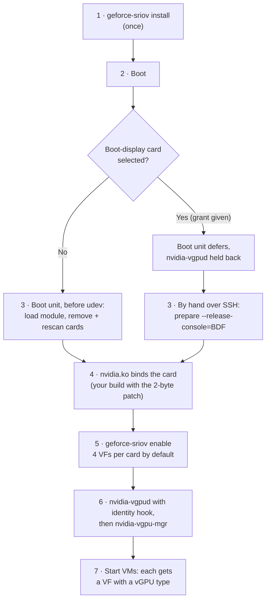

# Installation

The full guide, from an empty host to a VM with a vGPU. The [README](../README.md) has the short
version ([Quick start](../README.md#quick-start)) and helps you pick a path
([Which path do I need?](../README.md#which-path-do-i-need)). On the boot-display path, read
[The boot display GPU](boot-display.md) before you start. What has been measured, and what has not,
is listed in [What has been verified](../README.md#what-has-been-verified).

1. [Prerequisites checklist](#1-prerequisites-checklist)
2. [Build and check](#2-build-and-check)
3. [Patch the NVIDIA driver](#3-patch-the-nvidia-driver)
4. [Install](#4-install)
5. [Reboot and verify](#5-reboot-and-verify)
6. [Enable the virtual functions](#6-enable-the-virtual-functions)
7. [Register the vGPU types](#7-register-the-vgpu-types)
8. [Create a VM](#8-create-a-vm)

Afterwards: [Uninstall and rollback](#uninstall-and-rollback).

## What happens from install to a running VM



Steps 2 to 7 repeat at every boot. The driver patch sits in step 4: it is part of the `nvidia.ko`
you installed, so it is active whenever NVIDIA's driver loads. The identity hook sits in step 6:
it lives only inside `nvidia-vgpud`. On the boot-display path, step 3 is a command you run after
each boot ([details](boot-display.md)).

## 1. Prerequisites checklist

| ✓ | Requirement | How to check |
|---|---|---|
| ☐ | x86_64 Linux 6.8 or later, built with `CONFIG_LIVEPATCH` and `CONFIG_PCI_IOV`, not with Clang LTO | `uname -r`; `ls /sys/kernel/livepatch` must exist |
| ☐ | Kernel headers for the running kernel, `dkms`, a C compiler, `make` | `dkms status`; `cc --version`. On Proxmox, `pve-nvidia-vgpu-helper setup` installs headers and DKMS |
| ☐ | `systemd` and `pciutils` (`lspci`, `setpci`; NVIDIA's `sriov-manage` needs them) | `lspci --version` |
| ☐ | IOMMU on in firmware (VT-d / AMD-Vi) and kernel. In firmware also enable *Above 4G decoding*, and SR-IOV and ARI if offered | `dmesg \| grep -i -e DMAR -e IOMMU`; `ls /sys/kernel/iommu_groups` is not empty |
| ☐ | Your own NVIDIA vGPU host package for Linux KVM, proprietary flavour, installed with DKMS. Measured version: 580.159.01 | `modinfo -F version nvidia` prints the installed version without loading the module. (`/proc/driver/nvidia/version` exists only while `nvidia` is loaded) |
| ☐ | NVIDIA's vGPU daemon units `nvidia-vgpud.service` and `nvidia-vgpu-mgr.service` | `systemctl list-unit-files 'nvidia-vgpu*'` lists both. If not, see [below](#nvidias-vgpu-daemon-units) |
| ☐ | Guest drivers from the **same** vGPU software release as the host driver | NVIDIA's release notes map host to guest versions |
| ☐ | A valid NVIDIA vGPU licence setup of your own for the guests (outside this project) | |
| ☐ | A KVM hypervisor that gives each VM a VF with a vGPU type (measured: Proxmox VE, whose `hostpci` line names the type with `mdev=<type>`) | |
| ☐ | The card is in the device table, is function `.0`, has a PCI bridge directly above it and does not share its PCI bus with another device | `./geforce-sriov devices`; `./geforce-sriov doctor --device BDF` checks the rest |
| ☐ | Nothing loads `nvidia` before the boot unit: not in `/etc/modules`, `/etc/modules-load.d/` or the initramfs | `doctor` warns when it finds it |
| ☐ | (optional) A way back in: SSH, a way to cold power-cycle the machine (IPMI, a smart plug, or a hand on the power button), and netconsole or a serial console if available | |

Find your card's address (the *BDF*) with `lspci -D -nn -d 10de:`. The first column, for example
`0000:03:00.0`, is what every command here expects.

### NVIDIA's vGPU daemon units

Step 7 starts NVIDIA's two vGPU daemons, and `install` adds the identity hook to
`nvidia-vgpud.service` through a drop-in. So both unit files must exist:

```sh
systemctl list-unit-files 'nvidia-vgpu*'   # expect nvidia-vgpud.service and nvidia-vgpu-mgr.service
```

If they are missing, your host package was installed without them. NVIDIA's package ships them
under `init-scripts/systemd/` in the extracted driver package, and some installs keep copies in
`/usr/lib/nvidia/systemd/`. Copy both **unchanged** (from whichever of the two you have) and
reload systemd, before or after `install`:

```sh
sudo install -m 0644 /usr/lib/nvidia/systemd/nvidia-vgpud.service \
    /usr/lib/nvidia/systemd/nvidia-vgpu-mgr.service /etc/systemd/system/
sudo systemctl daemon-reload
```

You do not need to enable them: step 7 starts them after the VFs exist. Enable them only if you
want them started at every boot, and on the boot-display path leave them disabled. `doctor` warns
when either unit file is missing.

## 2. Build and check

Get the source of this repository on the host, then:

```sh
make            # builds geforce-sriov, hook/libgeforce_sriov.so, driver/geforce-sriov-patch
make check      # offline tests; no hardware is touched
./geforce-sriov devices                       # the cards it acts on
./geforce-sriov doctor --device 0000:03:00.0  # checks only; changes nothing
```

`doctor` prints one line per check, marked `[OK  ]`, `[INFO]`, `[WARN]` or `[FAIL]`, and ends
with a count. **Success** for this step is `0 failure(s)`. `doctor` cannot check everything the
later steps need (for example whether your `nvidia.ko` is the patched build). On a running host
where NVIDIA's driver already owns the card, this warning is normal and expected:

```text
[WARN] 0000:03:00.0: bound to nvidia now, so prepare cannot act on it this boot; the boot unit prepares it before NVIDIA binds if nothing loads nvidia earlier
```

Before `install`, these lines are normal too:

```text
[INFO] config: /etc/geforce-sriov/config absent; defaults apply and no device is selected
[WARN] kernel module for the running kernel not found under /lib/modules/$(uname -r) (geforce-sriov install builds it with DKMS)
```

A `[FAIL]` line names what `prepare` would refuse and why. Fix it before you continue; the
[Troubleshooting](troubleshooting.md) table covers the common ones. One `[FAIL]` is expected on the
boot-display path: before `install`, a boot-display card shows
`[FAIL] 0000:04:00.0: is the boot display device (boot_vga=1) …`. It goes away once `install`
records the console-release grant ([The boot display GPU](boot-display.md)).

`doctor` changes nothing. Besides sysfs, it reads the PCI configuration space of each card's
parent bridge to see whether the bridge supports ARI forwarding (fully only as root).

## 3. Patch the NVIDIA driver

Follow [driver-patch.md](driver-patch.md): copy NVIDIA's source tree, run
`geforce-sriov-patch apply` on your `nv-kernel.o_binary`, rebuild `nvidia.ko`, compare it with a
stock build, back up the stock module and install the patched one. After `make`, the patcher is
`driver/geforce-sriov-patch` in this repository; it is not on your `PATH` until `install` copies it
to `/usr/local/bin`. Do this **before the reboot** in step 5, so that the card is prepared and then
bound by the patched driver. The patcher checks the file's SHA-256 and refuses files it does not
recognise. Only 580.159.01 has been measured.

> [!WARNING]
> DKMS rebuilds the **stock** `nvidia.ko` after every kernel update. Re-apply the patch for each
> kernel you boot ([driver-patch.md](driver-patch.md#after-a-kernel-or-nvidia-driver-update)).

## 4. Install

```sh
sudo ./geforce-sriov install --device 0000:03:00.0
# several GPUs: one --device per GPU (at most 8)
# a lower VF count: add --vfs N, for example --vfs 2 (default 4)
# same thing via make: sudo make install DEVICES="0000:03:00.0"
```

What `install` does, and why:

| It… | So that… |
|---|---|
| copies `geforce-sriov` and `geforce-sriov-patch` to `/usr/local/bin` (`--prefix` changes it) | you can run them from anywhere |
| copies the hook to `/usr/local/lib/geforce-sriov/libgeforce_sriov.so` | the `nvidia-vgpud` drop-in can load it |
| copies the module source to `/usr/src/geforce-sriov-0.1.0/` and runs `dkms add`, `dkms build`, `dkms install` | the module is rebuilt for every new kernel |
| installs `/etc/systemd/system/geforce-sriov-prepare.service` and the drop-in `/etc/systemd/system/nvidia-vgpud.service.d/geforce-sriov.conf` | the card is prepared at boot and the hook is loaded into `nvidia-vgpud` only (NVIDIA's own unit must exist: [see above](#nvidias-vgpu-daemon-units)) |
| writes `/etc/geforce-sriov/config` with `bdfs=…`, `identity=on`, `identity_force_host=on` | the module, CLI and hook know which cards to act on |
| **enables** the boot unit for the next boot (it does not start it) | nothing changes on the card until you reboot |
| records every installed file and its SHA-256 in `/var/lib/geforce-sriov/installed-files` | `uninstall` removes exactly what it installed |

It refuses a card that is not in the device table, is the boot display (without
`--boot-display-release`), shares its bus with another device or has no PCI bridge above it.
Running it again leaves identical files alone (`unchanged …`). To start more cautiously you can
record `--ari=off` (and on Ada/Blackwell `--experimental-vfs=off`). Every option and config key is
listed in [configuration.md](configuration.md).

**Success:** the command exits 0 and its output contains
`geforce-sriov-prepare.service enabled for the next boot (not started now).`, followed by a few
hints. Before that, DKMS prints its own build lines, including `Sign command:` and `Signing key:`:
DKMS signs the module with its own key. The measured host ran with Secure Boot off. With Secure
Boot on, that key must be enrolled and your rebuilt `nvidia.ko` must be signed too; this guide
does not cover that.

Then run `doctor` once more, as `install` suggests:

```sh
sudo geforce-sriov doctor
```

It now reads the installed config. Expect `0 failure(s)` and a line
`[OK  ] geforce-sriov-prepare.service is enabled: …`.

## 5. Reboot and verify

Power the machine **fully off and on** for the first prepared boot. A cold boot gives the card a
clean start.

> [!TIP]
> To skip preparation for one boot, add `geforce_sriov.skip` to the kernel command line (in GRUB,
> press `e` on the entry and append it to the `linux` line). Nothing else changes.

After boot, check the boot unit and the card:

```sh
systemctl status geforce-sriov-prepare.service       # expect: active (exited)
journalctl -b -u geforce-sriov-prepare.service       # what it did
geforce-sriov status
```

Among other lines, the journal should show these, in this order (addresses differ on your host):

```text
modprobe geforce_sriov ari=1 msix=1 experimental_vfs=1 bdfs=0000:03:00.0
livepatch geforce_sriov enabled, transition complete
0000:03:00.0: bridge 0000:00:03.0 power/control auto -> on (held awake)
0000:03:00.0: remove 0000:03:00.1
0000:03:00.0: remove 0000:03:00.0
0000:03:00.0: rescan /sys/devices/…/pci_bus/0000:03/rescan
0000:03:00.0: sriov_totalvfs=4 ari_enabled=1 (ari=on)
```

`geforce-sriov status` should then show the card prepared, with 4 VFs available (the default count)
and none enabled yet:

```text
module geforce_sriov: loaded (ari=Y msix=Y experimental_vfs=Y vfs=4 bdfs=0000:03:00.0; livepatch enabled=1 transition=0)
guard: clear

0000:03:00.0: 10de:2206 GeForce RTX 3080 driver nvidia
  VFs: hardware default 16, geforce-sriov presents 4 (default)
  prepared this boot: yes
  SR-IOV: sriov_totalvfs=4 sriov_numvfs=0 ari_enabled=1
  next: `sudo geforce-sriov enable` (enable also checks sriov-manage and pciutils)
```

`status` exits 0 only when every selected card is ready. Before the first prepared boot it shows
`SR-IOV: not presented` and exits 1; that is expected, not an error. If it says something else,
each card line names its next step; see also [Troubleshooting](troubleshooting.md).

**On the boot-display path** the boot unit prepares nothing: it logs only a `deferred: …` message,
and you prepare the cards by hand. The expected output for that path is in
[The boot display GPU](boot-display.md#what-the-boot-unit-logs); the lines shown above for the
standard path appear in the output of `prepare` instead.

## 6. Enable the virtual functions

```sh
sudo geforce-sriov enable
```

It runs NVIDIA's `/usr/lib/nvidia/sriov-manage -e <card>` for each card prepared this boot, then
waits until every VF and the card itself are bound to `nvidia`. NVIDIA's driver must already own
the card (`status` shows `driver nvidia`). `enable` enables every VF the card presents
(`sriov_totalvfs`): 4 by default, or the count chosen with `install --vfs N`. `sriov-manage`
may briefly stop `nvidia-xid-logd`, moves the card through `pci-pf-stub` on the way and turns on
persistence mode (`nvidia-smi -pm 1`), which creates `/dev/nvidia0`, `/dev/nvidiactl` and so on;
that is normal.

**Success:** `0000:03:00.0: 4 VFs enabled and bound to nvidia`. `lspci -nn -d 10de:` now lists
four extra functions on the card's slot (on the measured cards `03:00.4` to `03:00.7`). On the
measured cards `sriov-manage` also printed
`/usr/lib/nvidia/sriov-manage: line 148: echo: write error: No such device` once per card, and the
kernel logged a few lines that look like errors; all are harmless
([Expected messages](troubleshooting.md#expected-messages)).

> [!NOTE]
> The VFs do not survive a reboot. Run `enable` after every boot (or put it in your own unit after
> `geforce-sriov-prepare.service`). `enable` acts only on cards prepared this boot.

## 7. Register the vGPU types

Run this only after step 6, when the VFs exist. Start NVIDIA's daemons in this order: first the
daemon that carries the hook, then the manager. Both are NVIDIA's units; if systemd answers
`Unit nvidia-vgpud.service not found`, install them first
([NVIDIA's vGPU daemon units](#nvidias-vgpu-daemon-units)).

```sh
sudo systemctl restart nvidia-vgpud.service
sudo systemctl restart nvidia-vgpu-mgr.service
```

`nvidia-vgpud` registers the types and exits: `systemctl status nvidia-vgpud` then shows
`inactive (dead)` with `status=0/SUCCESS`, which is normal for this one-shot service.
`nvidia-vgpu-mgr` stays `active (running)`. Its start runs `nvidia-vgpud` once more (NVIDIA's unit
requires it), so the hook lines below can appear twice.

**Success:** the hook logs one line per card, and each VF lists vGPU types:

```sh
journalctl -b -u nvidia-vgpud.service | grep geforce-sriov-hook
cat /sys/bus/pci/devices/0000:03:00.4/nvidia/creatable_vgpu_types   # 0000:03:00.4 = a VF
```

With the measured driver this shows:

```text
geforce-sriov-hook: card 0000:03:00.0: GeForce RTX 3080 (10de:2206, GA102) presented as RTX A6000 (10de:2230), subsystem kept
```

```text
ID    : vGPU Name
522   : NVIDIA RTXA6000-1B
…
527   : NVIDIA RTXA6000-4Q
…
```

The number in the first column is the type ID. Proxmox calls that type `nvidia-<ID>`, for example
`nvidia-527` for `RTXA6000-4Q`. On Proxmox the web UI also lists the types when you add a VF to a
VM ([step 8](#8-create-a-vm)). Restart `nvidia-vgpud` again after any PCI rescan or hot-plug.

## 8. Create a VM

Each VF backs one vGPU. On Proxmox VE, add it in the web UI (VM → Hardware → Add → PCI Device →
pick a VF, then an *MDev Type*), or on the command line:

```sh
qm set <vmid> -hostpci0 0000:03:00.4,mdev=nvidia-527
```

The type name (`nvidia-527` here) is only an example: names and numbers depend on your host
driver. Pick the type from the list in step 7 or the web UI, and keep the
[memory limit](../README.md#how-it-works) in mind. On other hypervisors, follow your hypervisor's
and NVIDIA's documentation for giving a VM a vGPU on a VF.

After `qm start <vmid>`, check that the VF carries the type:

```sh
cat /sys/bus/pci/devices/0000:03:00.4/nvidia/current_vgpu_type   # the type ID, e.g. 527; 0 = none
```

`qm start` printed two `kvm: … warning:` lines per VF in the measured setup, and
`nvidia-vgpu-mgr` logs `Failed to set guest license state in host` when a guest driver loads. The
guests worked; see [Expected messages](troubleshooting.md#expected-messages).

In the guest, install NVIDIA's **vGPU guest driver** from the same release as the host driver,
then configure your own licensing (outside this project). A bare-metal or Data Center driver will
not work in a vGPU guest (on Windows it typically shows Code 43).

## Uninstall and rollback

```sh
sudo geforce-sriov uninstall
```

This disables the boot unit, removes the DKMS module and deletes only the installed files whose
content is unchanged (an edited config is kept and reported). The livepatch stays loaded until the
next boot, which is then an ordinary boot. `--unload` unloads it right away, but only when no card
has VFs and none was prepared this boot, so in practice: uninstall, then reboot.

Then put back NVIDIA's stock `nvidia.ko` from your backup (or rebuild it from the untouched
`/usr/src/nvidia-<version>` tree) and reboot. Details, the guard and every switch:
[recovery.md](recovery.md).
