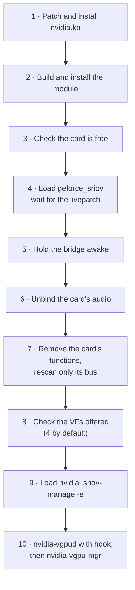

# Manual method

This page shows, step by step, what the `geforce-sriov` CLI and its boot unit do, so that you can
understand the method or reproduce it by hand.

> [!WARNING]
> **Use the CLI for normal operation.** Before it changes anything, the CLI checks every selected
> card, writes a guard that blocks the next boot's preparation if a run does not finish, blocks
> signals during the remove/rescan, and gives back what it changed when it refuses. By hand you have
> none of that. If a card does not come back after a rescan, do **not** rescan again: power the
> machine fully off and on ([recovery.md](recovery.md)).

The examples use these addresses; replace them with yours:

| Name | Example | How to find it |
|---|---|---|
| Card (PF) | `0000:03:00.0` | `lspci -D -nn -d 10de:` |
| Card's audio function | `0000:03:00.1` | same slot, function 1, class `0403` |
| Bridge above the card | `0000:00:03.0` | `basename "$(dirname "$(readlink -f /sys/bus/pci/devices/0000:03:00.0)")"` |
| Card's bus | `0000:03` | domain and bus of the card |

Run everything as root.

## Overview



Steps 3–8 are what `geforce-sriov prepare` does (at boot through `geforce-sriov-prepare.service`).
Step 9 is `geforce-sriov enable`. They must run in a boot **before** anything binds the card, which
is why the boot unit runs before `systemd-udevd`.

## 1. Patch and install NVIDIA's driver

Not automated by the package. Follow [driver-patch.md](driver-patch.md): run
`geforce-sriov-patch apply` on a copy of your own `nv-kernel.o_binary`, rebuild `nvidia.ko`, and
install it in place of the stock module. Replace the module only while no VF exists; installing it
and rebooting is the simplest safe order.

## 2. Build and install the kernel module

Either build it once for the running kernel:

```sh
make module                 # builds kernel/geforce_sriov.ko against /lib/modules/$(uname -r)/build
```

or do what `install` does, so DKMS rebuilds it for every kernel:

```sh
mkdir -p /usr/src/geforce-sriov-0.1.0/include
cp kernel/geforce_sriov.c kernel/Kbuild kernel/Makefile kernel/dkms.conf /usr/src/geforce-sriov-0.1.0/
cp include/gs_devices.h /usr/src/geforce-sriov-0.1.0/include/
dkms add -m geforce-sriov -v 0.1.0
dkms build -m geforce-sriov -v 0.1.0
dkms install -m geforce-sriov -v 0.1.0
```

The module has no device table on purpose, so it never loads by itself.

## 3. Check that the card is free

`prepare` refuses the card unless all of these hold. Check them before you touch anything:

- it is function `.0`, an NVIDIA display controller, listed in `geforce-sriov devices`;
- it is **not** the boot display: `cat /sys/bus/pci/devices/0000:03:00.0/boot_vga` prints `0`
  (for the boot display, use the CLI's console-release path; do not do it by hand);
- no driver is bound: `/sys/bus/pci/devices/0000:03:00.0/driver` does not exist;
- the only bound function in its slot, if any, is its own HDMI audio on `snd_hda_intel`;
- no VFs exist on its bus, and no other device shares its bus (`ls /sys/bus/pci/devices | grep '^0000:03:'`
  lists only the card's own functions);
- it does **not** already show `sriov_totalvfs` (that would mean another kernel change presents
  SR-IOV; the package does not stack on it);
- the parent is a PCI bridge with `pci_bus/0000:03/rescan` and a readable `power/control`;
- BAR0 is assigned: the first line of `/sys/bus/pci/devices/0000:03:00.0/resource` is not all zeros.

`geforce-sriov doctor --device 0000:03:00.0` performs exactly these checks without changing
anything.

## 4. Load the module and wait for the livepatch

This is the command `prepare` runs, with the config's switches as `0`/`1` (and `vfs=N` when the
config sets a VF count):

```sh
modprobe geforce_sriov ari=1 msix=1 experimental_vfs=0 twin_id=0 bdfs=0000:03:00.0
```

| Parameter | Default | Meaning |
|---|---|---|
| `bdfs` | none (required) | Comma-separated card addresses, at most 8. Only these are changed; empty refuses to load |
| `vfs` | `4` | VFs presented per listed card, 1–16, never more than the card's hardware TotalVFs (on Ada and Blackwell 1, unless `experimental_vfs=1`). Every VF must land on a free function 1–7 of the card's slot or the module refuses to load. The default is 4 because ARI decoding in the GPU hardware does not work for now |
| `ari` | `1` | Enable ARI in software: present the hidden ARI capability and turn on ARI Forwarding in the bridge above. ARI decoding in the GPU hardware does not work for now, which is why `vfs` defaults to 4 either way. The module cannot see `pci=noari`: if your kernel command line has it, pass `ari=0` (`prepare` does this for you) |
| `msix` | `1` | On Ampere, reveal the card's hidden MSI-X at load |
| `experimental_vfs` | `0` | Ada/Blackwell only, for experiments: where the card reports 1 VF, present up to 4 (`vfs`) instead of 1. On Blackwell NVIDIA's driver also sees the raised count, and the GPU firmware may still refuse more than 1 VF (untested); on Ada only Linux sees it, and on the one measured Ada card only the first VF reached a vGPU ([Ada and Blackwell](devices.md#ada-and-blackwell)) |
| `twin_id` | `0` | RTX 5090 only, experimental and untested: show NVIDIA's driver the vGPU target's ID when it starts the GPU. It may make the GPU firmware fail to start. Refused when none of the listed cards is an RTX 5090, or when a listed RTX 5090 is behind a hotplug-capable port or has a driver bound; on other listed cards it has no effect ([twin_id](devices.md#twin_id-rtx-5090-only)) |

The parameters cannot be changed while the module is loaded; to change them, reboot. Then wait
until the livepatch is active (the CLI waits up to 15 seconds):

```sh
cat /sys/kernel/livepatch/geforce_sriov/enabled      # must be 1
cat /sys/kernel/livepatch/geforce_sriov/transition   # must be 0
```

If `modprobe` fails, nothing was changed; the kernel log (`journalctl -k -b | grep geforce_sriov`)
names the reason.

## 5. Hold the bridge above the card awake

A bridge that runtime-suspends during the rescan loses the card. Save its current setting, force it
on, and wait until it reports `active` (or `unsupported`, meaning runtime power management is off):

```sh
B=/sys/bus/pci/devices/0000:00:03.0
OLD=$(cat $B/power/control)
echo on > $B/power/control
cat $B/power/runtime_status                          # active (or unsupported)
```

## 6. Unbind the card's own HDMI audio function

Only the card's own audio function bound to `snd_hda_intel` is unbound; anything else bound in the
slot means stop.

```sh
echo 0000:03:00.1 > /sys/bus/pci/devices/0000:03:00.1/driver/unbind
```

Removing an audio function that was active this boot can log a blocked DMAR fault (late audio DMA);
unbinding does not prevent it.

## 7. Remove the card's functions and rescan only its bus

The CLI removes every other function in the card's slot, then the card itself, waiting up to
5 seconds for each to disappear, and then rescans **only the card's own bus** through the bridge
above it:

```sh
echo 1 > /sys/bus/pci/devices/0000:03:00.1/remove
echo 1 > /sys/bus/pci/devices/0000:03:00.0/remove
echo 1 > /sys/bus/pci/devices/0000:00:03.0/pci_bus/0000:03/rescan
```

> [!CAUTION]
> Do not remove or rescan other devices, do not use the global `/sys/bus/pci/rescan`, and do not do
> this on a bus another device shares. The package refuses all of these. During the rescan the
> kernel may log `VF BAR … can't assign` messages before it settles; check the final state in
> step 8.

Wait for the card to come back (the CLI waits up to 10 seconds), with the same vendor and device
ID, and for `sriov_totalvfs` to appear. Then put the bridge setting back:

```sh
ls /sys/bus/pci/devices/0000:03:00.0/sriov_totalvfs
echo "$OLD" > /sys/bus/pci/devices/0000:00:03.0/power/control   # only if it was not "on"
```

If the card does not come back, stop: cold power cycle, no second rescan.

## 8. Check what the card now offers

```sh
cat /sys/bus/pci/devices/0000:03:00.0/sriov_totalvfs   # must be 1 to vfs (4 on the measured cards)
cat /sys/bus/pci/devices/0000:03:00.0/ari_enabled      # 1 with ari=1, when the bridge supports it
sed -n '1p;8,13p' /sys/bus/pci/devices/0000:03:00.0/resource
```

Line 1 of `resource` (BAR0) must not be zeros. At least one of lines 8–13 (the VF BARs) must not be
zeros, otherwise enabling VFs fails with `not enough MMIO resources for SR-IOV`; enable *Above 4G
decoding* or boot with `pci=realloc`. A value outside 1 to `vfs` means: do not enable VFs.

The CLI also records the result in `/run/geforce-sriov/prepared/0000:03:00.0`. `geforce-sriov
enable` refuses a card without that record, so after a manual preparation you enable by hand
(step 9).

## 9. Load NVIDIA's driver and enable the VFs

At boot, udev loads `nvidia` after the boot unit has finished. By hand:

```sh
modprobe nvidia
readlink /sys/bus/pci/devices/0000:03:00.0/driver   # must end in /nvidia
/usr/lib/nvidia/sriov-manage -e 0000:03:00.0
```

`sriov-manage` is NVIDIA's own script and the only VF enable method NVIDIA supports. It needs
`lspci` and `setpci`. It may stop `nvidia-xid-logd` briefly, moves the card through `pci-pf-stub`
while it sets the VF count, rebinds it to `nvidia`, binds the slot's other functions to `nvidia`
and runs `nvidia-smi -pm 1`. Its exit status is not reliable, so check the result:

```sh
cat /sys/bus/pci/devices/0000:03:00.0/sriov_numvfs     # equals sriov_totalvfs
for v in /sys/bus/pci/devices/0000:03:00.0/virtfn*; do echo "$v -> $(basename "$(readlink "$v/driver")")"; done   # each: nvidia
```

> [!CAUTION]
> Do not write `sriov_numvfs` yourself: NVIDIA's `sriov-manage` must set the VF count, because it
> also moves the card through `pci-pf-stub` and binds every function to `nvidia`. Do not try to get
> more VFs than the presented count.

## 10. Start the vGPU daemons

The identity hook is loaded into `nvidia-vgpud` only, through the drop-in
`/etc/systemd/system/nvidia-vgpud.service.d/geforce-sriov.conf`:

```ini
[Unit]
After=geforce-sriov-prepare.service
AssertPathExists=!/run/geforce-sriov/deferred

[Service]
Environment=LD_PRELOAD=/usr/local/lib/geforce-sriov/libgeforce_sriov.so
```

The hook only acts when `/etc/geforce-sriov/config` is root-owned, not group- or world-writable,
lists the card in `bdfs=` and has `identity=on` (and `identity_force_host=on`, as `install` writes).
Do not load it globally (for example through `/etc/ld.so.preload`) or into `nvidia-vgpu-mgr`.

Both daemons are NVIDIA's units. If `systemctl list-unit-files 'nvidia-vgpu*'` does not list
`nvidia-vgpud.service` and `nvidia-vgpu-mgr.service`, install them first
([NVIDIA's vGPU daemon units](installation.md#nvidias-vgpu-daemon-units)). Start them only after the VFs exist.

```sh
systemctl daemon-reload
systemctl restart nvidia-vgpud.service
systemctl restart nvidia-vgpu-mgr.service
journalctl -b -u nvidia-vgpud.service | grep geforce-sriov-hook
```

## 11. Create vGPUs

The package does not create vGPUs. On Proxmox VE, the VM's `hostpci` entry with `mdev=<type>`
makes Proxmox create the vGPU on the chosen VF when the VM starts (see
[Create a VM](installation.md#8-create-a-vm)). On other hypervisors, follow your hypervisor's and NVIDIA's
documentation for your driver version; that interface is not part of this source, so it is not
described here.

## Undoing it

- **VFs:** the package never disables VFs, so this page does not describe it; the simplest
  complete undo is a reboot.
- **Module:** do not unload `geforce_sriov`, `nvidia` or `nvidia_vgpu_vfio` while VFs exist. The CLI's
  `uninstall --unload` disables the livepatch, waits for the transition and runs `rmmod`, and it
  refuses while any listed card has VFs or was prepared this boot. A card that was rescanned keeps
  using the revealed capability until it is removed and rescanned again, so in practice: reboot.
- **Everything:** the next boot without the module (or with `geforce_sriov.skip` on the kernel
  command line while the unit is installed) is an ordinary boot.
