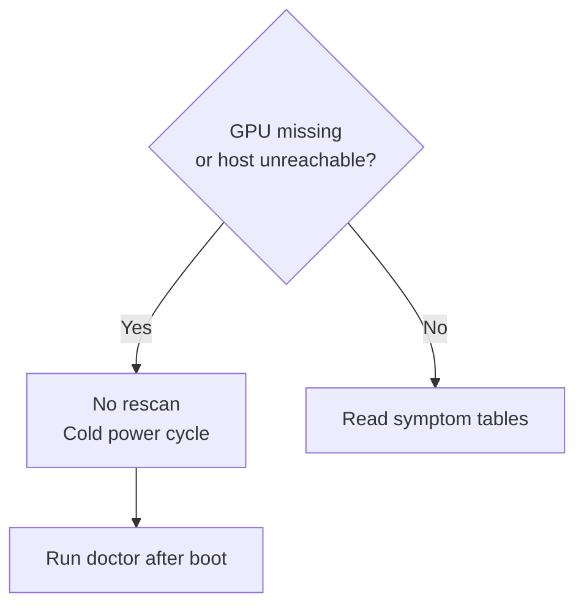
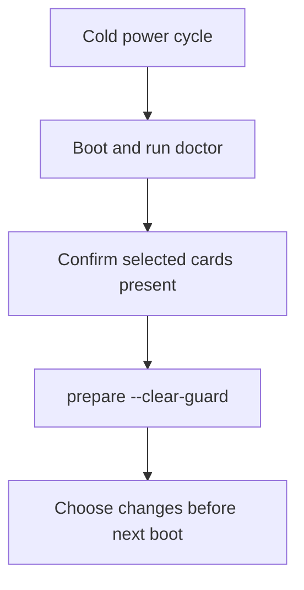
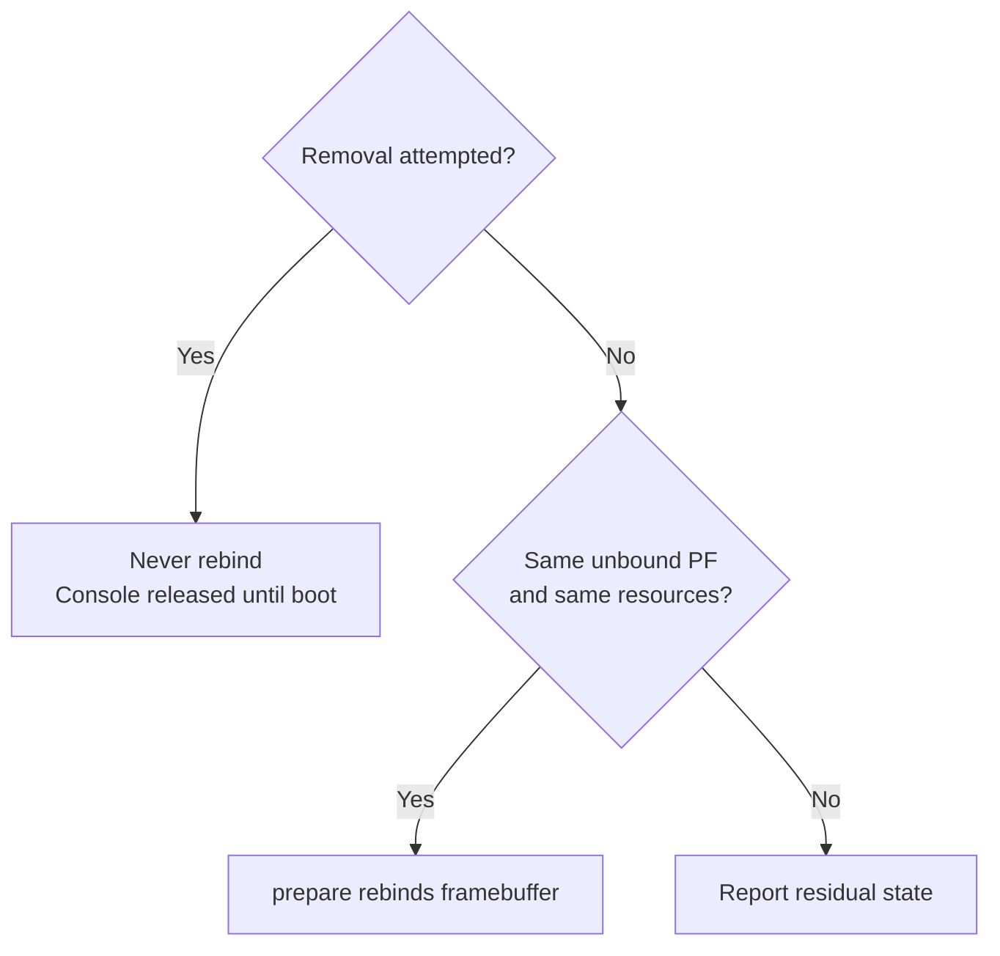

# Recovery

This page covers recovery when a card or host misbehaves.
Read it before you need it.
Start diagnosis with `geforce-sriov status` and `geforce-sriov doctor`: `status` names each card's next step.

## The one rule

If a card disappears from `lspci` after preparation, or the host cannot be reached, power the machine fully off and on.
This requires a cold power cycle, not a reboot.
Do not rescan the PCI bus or warm-reboot repeatedly.
Rescanning a bus whose GPU has left it can take the kernel down, and a GPU that stops answering config cycles comes back only after a full power-off.



Keep SSH access, and netconsole or a serial console if available, so you can read logs remotely.

## Symptoms

| Symptom | Cause | What to do |
|---|---|---|
| `prepare` or the boot unit exits with status 5: `guard … is set` | An earlier preparation did not finish | Cold power cycle, run `geforce-sriov doctor`, then `sudo geforce-sriov prepare --clear-guard` ([The guard](#the-guard)) |
| `refused: … already presents SR-IOV (sriov_totalvfs=…) from another kernel change (patched kernel or other livepatch)` | Another kernel change already presents SR-IOV on the card, and `prepare` does not stack on it | Boot a kernel without that change, then run `doctor`. If the other change already gives the VFs you need, skip preparation for that boot (`geforce_sriov.skip`, see [Turn features off](#turn-features-off)) |
| `refused: … is the boot display device (boot_vga=1)` | The card shows the boot console | Use another display, or opt in: [Boot display card](installation.md#boot-display-card) |
| `refused: … bound to driver 'nvidia'` at boot, or `doctor` warns that `nvidia` loads from `modules-load.d`, `/etc/modules` or the initramfs | Something loads `nvidia` before the boot unit | Remove `nvidia` from those lists, rebuild the initramfs, then power the machine off and on |
| `doctor`: `[WARN] NVIDIA's driver … is not supported`, or `activate`: `NVIDIA's driver … is not supported; continuing` | The host driver version is not 580.159.01, which is not supported | Both commands warn and continue. For a supported host, use 580.159.01 ([Supported software stack](installation.md#supported-software-stack)) |
| `doctor`: `NVIDIA driver … the identity hook passes this version through unchanged` | A host driver version other than 580.159.01, which is not supported, and one the hook does not know | Keep going. The hook passes this version through unchanged, so no vGPU types appear for the cards on it |
| `install`: `refused: module .text differences are not the eight expected offsets; first unexpected offset: …` or `module .text sizes differ; first unexpected offset: …` | The module the driver step built differs from the installed stock module somewhere other than the eight recorded offsets: a tree for another driver version, another compiler or other module options compile differently | The driver step changed none of NVIDIA's files. Keep the stock module, or use `--driver=skip` and follow [The manual path](driver-patch.md#the-manual-path) ([Compare with a stock build](driver-patch.md#compare-with-a-stock-build)) |
| `install`: `refused: the installed module … is already this build, but … is missing or wrong. Reinstall the stock module first, or install with --driver=skip to keep this module as it is` | The installed `nvidia.ko` already has this build's `.text`, but the modprobe option, the patched plugin copy or this kernel's backup of the stock module is missing or wrong. A missing record, or one written for another kernel, is repaired when those are in place, and a plugin copy from an earlier install with only the placement change is replaced | Put NVIDIA's stock `nvidia.ko` back ([Reverting](driver-patch.md#reverting)), then run `install` again; or, for a module you patched by hand, run `install --driver=skip` |
| `activate` refuses, or `doctor` warns: ``… is an earlier copy without the Ada framebuffer change. Run `sudo geforce-sriov install` again …`` | The plugin copy is the one an earlier version of this package made, with only the placement change (`7ddfad45…`) | Run `sudo geforce-sriov install` again, which replaces it with the patched plugin copy (`aa4fdeb5…`), then `sudo geforce-sriov activate` with no VM running |
| `status` shows `SR-IOV: not presented` (exit 1) | Not prepared this boot, or preparation failed. Expected after `install` until the first boot that prepares the card | Follow the next step `status` prints, and read `journalctl -b -u geforce-sriov-prepare.service` |
| One of several selected cards is refused, and nothing is prepared | `prepare` checks every selected card first and changes nothing when one fails | Fix that card, or remove it from `bdfs` to prepare the others |
| `doctor` or `prepare` reports BAR0 unassigned, or a card came back from the rescan without BAR0 | The bridge windows above the card are too small | Follow [the one rule](#the-one-rule), then enable *Above 4G decoding* in the firmware or boot with `pci=realloc`, and skip preparation (`geforce_sriov.skip`) until BAR0 is assigned again |
| `activate`: `not enough MMIO resources for SR-IOV`, or `status`/`doctor` report no VF BAR assigned | The bridge window above the card is too small for the VF BARs. The package never resizes the windows of a switch or of bridges further up | Enable *Above 4G decoding* in firmware, or boot with `pci=realloc` |
| Kernel log `geforce_sriov: first VF offset … ; refusing` (module not loaded), or `VF layout for … requested VFs … SR-IOV is not set up on this PF` | The card's VF layout does not fit its own slot, or its NumVFs register does not take the kernel's value | If `vfs` is above the default of 4, set it back to 4 or lower (or remove the line), then power the machine off and on. Otherwise no setting helps; remove the card from `bdfs` |
| Kernel log `unexpected VF layout after SR-IOV setup` | The card reported another layout at VF enable than at setup | Disable the VFs, cold power cycle, and do not rely on that card's VFs |
| VF enable fails after a vendor livepatch service (for example Ubuntu Livepatch) applied a cumulative "replace" livepatch | Such a patch silently disables `geforce_sriov` | Disable the vendor livepatch service, then power the machine off and on |
| `<BDF> (10de:<id>) is not in the device table` from `doctor`, `install --device`, `setup`, `activate` or `check` | The card's ID is not listed, for example a Blackwell card | Select only cards that `geforce-sriov devices` lists ([Supported cards](devices.md)) |
| `/etc/geforce-sriov/config: line N: unknown key 'experimental_vfs'; delete this line` (or `'twin_id'`) | The config holds a key geforce-sriov does not have | Delete that line from `/etc/geforce-sriov/config`, then run the command again |
| Ada card: NVIDIA's stock proprietary host module does not take the card | NVIDIA's stock module refuses Ada on a vGPU host (`rm_is_supported_device` returns `NV_ERR_NOT_SUPPORTED`) | Run `install` without `--driver=skip`: it makes the three host-object revisions and rebuilds `nvidia.ko`, loaded with `NVreg_EnableGpuFirmware=0` ([What install does](driver-patch.md#what-install-does)). With `--driver=skip`, do it by hand ([The manual path](driver-patch.md#the-manual-path), [Ada host stack](ada.md#host-stack)) |
| Ada card: Linux shows 4 VFs, but a vGPU on any VF after the first fails with `NV_ERR_OUT_OF_RANGE` (`0x5B`) | The loaded `nvidia.ko` lacks the VF-count revision | Run `install` again, or on the manual path build the module from an object that carries all three revisions ([Revisions](driver-patch.md#revisions)) and install it. Then power the machine off and on |
| `doctor`: `[WARN]` that the selection mixes Ada with another generation | The host module forces every TU/GA/AD card bound to it to 4 VFs ([Combining generations](devices.md#combining-generations)) | Nothing to fix. The warning does not stop `install`, `prepare` or `activate`; select cards of one generation to avoid it |
| `activate` reports that a selected card is not bound to `nvidia` | NVIDIA's host driver is not loaded | `modprobe nvidia`, wait, and run `activate` again |
| `modprobe nvidia` fails or loads nothing | A modprobe.d rule `install nvidia /bin/false` blocks it (for example the one from [Boot display card](installation.md#boot-display-card)) | `modprobe --ignore-install nvidia` |
| `Unit nvidia-vgpud.service not found` (or `nvidia-vgpu-mgr.service`) | NVIDIA's unit files are not installed | [NVIDIA's vGPU daemon units](installation.md#nvidias-vgpu-daemon-units) |
| VFs exist but no vGPU types appear | `nvidia-vgpud` started before the VFs, or the hook is off | Run `activate`, which restarts both daemons in order. If the patched plugin copy is not installed, run `sudo geforce-sriov install` first. Then check `identity=on` and the hook log lines |
| `nvidia-vgpud` fails with an assertion on `/run/geforce-sriov/deferred` | Boot-display grant: the cards are not prepared this boot | Run `geforce-sriov setup`, or its four commands by hand: `prepare --release-console=…`, `modprobe --ignore-install nvidia`, `activate`, `check` ([Boot display card](installation.md#boot-display-card)) |
| `setup` exits 3: `NVIDIA's driver is loaded, so the console GPU cannot be released in this boot. …` | Boot-display grant, and something loaded `nvidia` at boot, so it bound the console card before `prepare` | Create the hold ([Boot display card](installation.md#boot-display-card)), power the machine off and on, then run `setup` again |
| `doctor`: `nvidia is held back at boot by <file>, and no console release is granted. activate will refuse. …`, or `activate --boot` refuses each boot because NVIDIA's driver is not loaded | The hold from [Boot display card](installation.md#boot-display-card) is still in `/etc/modprobe.d/` after the grant was removed, so nothing loads `nvidia` | Remove that file ([Returning to automatic preparation](installation.md#returning-to-automatic-preparation)), then power the machine off and on |
| `doctor`: `<file> sets LD_PRELOAD for nvidia-vgpud and overrides the geforce-sriov identity hook. …` (or `nvidia-vgpu-mgr`) | Another drop-in of that unit preloads its own library, and systemd keeps the last `LD_PRELOAD`, so the identity hook is not loaded | Remove that drop-in, or point its `LD_PRELOAD` at the hook path `doctor` names, then run `systemctl daemon-reload` and `activate` with no VM running |
| VM does not start, or the start fails with an error about the vGPU type | The type does not fit the free memory, or the VFs or daemons are not ready. On an Ada card with a large type, the VF's framebuffer slot ends near the top of the card's memory; `activate` names such VFs after it sets the types | Run `geforce-sriov check`, put the VM on a lower VF or pick a smaller type ([Choosing a vGPU type](configuration.md#choosing-a-vgpu-type)), and make the daemons ready with `activate` (install the patched plugin copy first with `sudo geforce-sriov install`) |
| `check` reports `NOT READY … type=<old> expected=<new>` after `type_ada` or `type_ampere` changed | The config names a new type and the VFs still carry the old one | Stop the VMs on that card, write `0` to `nvidia/current_vgpu_type` of each of its VFs while `nvidia-vgpu-mgr` runs, then run `activate` |
| Windows guest shows Code 43 | The guest has a bare-metal or Data Center driver instead of the vGPU guest build, or lacks `RMSetVgpuGspPluginOffloadMode=0` | Install the vGPU guest driver listed for your card and set the DWORD ([Guests](installation.md#guests)) |
| `activate` refuses: `nvidia.ko for … is not the driver step's build …`, or `nvidia.ko for … is not known to be the driver step's build: … records kernel …` | The record does not name the installed `nvidia.ko` for the running kernel, for example because DKMS rebuilt the stock module after a kernel update, or the record was made on another kernel | Run `sudo geforce-sriov install` on this kernel, which rewrites the record when the installed module is this build, then power-cycle ([After a kernel or NVIDIA driver update](driver-patch.md#after-a-kernel-or-nvidia-driver-update)). With no record at all (`--driver=skip`), `activate` only warns |
| `doctor`, `status`, `check` or `activate`: `the running nvidia module (build-id …) is not the installed one (…); power the machine off and on to load it` | The installed `nvidia.ko` is the driver step's build, and the running `nvidia` module is not, for example after `install` or the driver step put a new build in place without a power cycle | Cold power cycle, so the installed build is loaded. Until then `status` exits 1, and `activate` warns and continues on the loaded module |
| `activate`: `type <N> is not in nvidia/creatable_vgpu_types …; nothing written. The driver keeps the vGPU types it registered first after a boot, so after a change of identity or target, power the machine off and on` | NVIDIA's `nvidia_vgpu_vfio` keeps the type table of each GPU's first registration until the next boot. Neither a PF re-probe nor a daemon restart refreshes it, so after a change of identity or target the old table stays | Cold power cycle, then run `activate` again |
| `uninstall` exits 1 and prints `NVIDIA's module was not restored: …` | Restoring NVIDIA's `nvidia.ko`, plugin link or modprobe file did not complete | `uninstall` kept `geforce-sriov-driver` and every backup in `/var/lib/geforce-sriov/stock/`. The message gives the reason and the two ways to finish: fix the reason, then run `geforce-sriov-driver --restore`, or copy `/var/lib/geforce-sriov/stock/<kernel release>/nvidia.ko` over the installed `nvidia.ko` and run `depmod -a <kernel release>`; [Reverting](driver-patch.md#reverting) covers the plugin link and the modprobe file ([Remove the package](#remove-the-package)) |
| Guest GPU work stalls | The stock `nvidia.ko` is loaded (DKMS rebuilt it after an update) | Run `install` again for this kernel ([After a kernel update](installation.md#after-a-kernel-update)); on the manual path re-apply the [driver patch](driver-patch.md#after-a-kernel-or-nvidia-driver-update) |

`activate` and `check` act on every selected Ada or Ampere card.
After a manager restart or a re-probe of any card's PF (its physical function, the card itself):

1. Stop the VMs on every card.
2. Set their VFs' types to `0`.
3. Run `activate` again.

A udev rule or a service that writes `on` to the VFs is no replacement.

`activate` sets the guard around each PF re-probe.
If a PF does not come back to `nvidia`, it exits 5, leaves the guard set and powers none of that card's VFs; recover as in [The guard](#the-guard).
Any other stop after it has restarted NVIDIA's daemons exits 1.
To undo the VF power and type settings, see [Turn features off](#turn-features-off).

The supported generations are Ampere and Ada; see [Ampere](ampere.md) and [Ada](ada.md).

## activate and check

| Situation | Cause | What to do |
|---|---|---|
| `activate` exits with status 3 | A check failed and nothing was changed | Fix what the message names and run `activate` again |
| `activate` exits with status 5 | The guard was set, or the PF did not come back to `nvidia` after the re-probe | Cold power cycle, run `geforce-sriov doctor`, then `sudo geforce-sriov prepare --clear-guard` ([The guard](#the-guard)) |
| `activate` refuses: `each VF below has a vGPU, and restarting NVIDIA's vGPU daemons would end it:`, one line per VF | A vGPU exists on the host, and the manager restart would end it | Stop the VMs that use those VFs, run the `for f in …; do echo 0 > /sys/bus/pci/devices/$f/nvidia/current_vgpu_type; done` line the refusal prints (it names every such VF, also those past the eighth that the list only counts), then run `activate` again |
| `activate` refuses because a GPU that is not selected has VFs enabled | The daemon restart is host-wide | Stop the VMs on that GPU and disable its VFs with NVIDIA's `sriov-manage -d <PF>`, then run `activate` again |
| A leftover `/run/geforce-sriov/activating` marker: `doctor` warns `/run/geforce-sriov/activating exists: geforce-sriov activate is running or did not finish; check reports NOT READY until activate succeeds`, `status` prints `activate: /run/geforce-sriov/activating exists (activate is running or did not finish)` and exits 1 | An earlier `activate` did not finish, or one is running | When no `activate` is running: stop every VM that uses a vGPU and run `activate` again. The leftover file does not block it, and a successful run removes it. Start no VM until `check` passes |
| `activate` refuses because of `driver_override` on a PF | A `driver_override` is set on the PF | `echo > /sys/bus/pci/devices/<PF>/driver_override`, then run `activate` again |
| `activate` exits with status 1, `unbindLock` not granted (`activate stopped at <PF> …`) | A program still holds the GPU (`nvidia-smi` loops, `nvidia-persistenced`, a CUDA program). The cards before it were already re-probed and powered, but `check` reports `NOT READY` for every card until `activate` succeeds | Stop it. Then read `nvidia/current_vgpu_type` of every VF and write `0` to any that is not `0`, because `activate` sets a type on every VF and refuses while one is set. Run `activate` again |
| `check` reports `NOT READY` with `power/control=auto` or `runtime_status=suspended` | A manager restart or a PF re-probe put VFs back to `auto`, and a re-probe on one card did so for the other cards' VFs too | Start no VM. Stop the VMs on every card, set every VF's type to `0`, and run `activate` again |

## The guard

The guard prevents preparation from running again after an unfinished attempt until you have done a cold power cycle and cleared it.
`geforce-sriov prepare` writes `/var/lib/geforce-sriov/prepare-attempt` before it changes anything and removes it once every selected card is back in a known state.
The file stays if preparation is interrupted, for example by a reset or power loss, or if a card does not come back.
While it exists:

- the boot unit and `geforce-sriov prepare` refuse to run and exit with status 5;
- `geforce-sriov activate` refuses to create VFs (status 5);
- `geforce-sriov doctor` and `status` report it.

Later boots are ordinary boots without preparation.
To clear the guard:

1. Cold power cycle.
2. Boot and run `geforce-sriov doctor`.
   Every selected card should be present.
3. Run `geforce-sriov prepare --clear-guard`.
   It refuses (status 5) if the unfinished attempt was made in the current boot.
   It can only detect a changed boot ID, not whether the reboot was a full power-off.
   You must ensure the machine was powered fully off.
4. Decide what to change (see [Turn features off](#turn-features-off)) before the next boot runs preparation again.



If preparation is refused after it had already unbound the card's HDMI audio function, it rebinds that function to `snd_hda_intel` when the function is still present, unbound and the same device.
Otherwise it prints `residual state: …` and leaves the function alone.

## The released console of the boot display GPU

On the boot display GPU (the card that shows the startup screen and the text console), `prepare` releases the console before preparing the card.
A failure can leave that console released.
`prepare --release-console=BDF` writes the guard before it unbinds the boot display's firmware framebuffer.
Recovery depends on whether card removal was attempted:

- If `prepare` refuses or fails before removal is attempted, it rebinds the framebuffer only while the PF is the same unbound device with the same resources.
  Otherwise it prints `residual state: …`.
- After removal is attempted, it never rebinds because the BARs may have moved.
  The console stays released until the next boot, and nothing brings it back during that boot.
  Do not rebind it by hand.



Once `prepare --release-console` has released the card, its framebuffer console stays gone until the next boot ([Combining generations](devices.md#combining-generations)).

While the boot unit has deferred (`/run/geforce-sriov/deferred` exists), `nvidia-vgpud` and the units that require it refuse to start.
The record is removed once every selected GPU is prepared, and it does not survive a reboot.
To stop deferring, run `geforce-sriov install --device BDF` for the other GPUs only (without `--boot-display-release`), and remove the hold `/etc/modprobe.d/nvidia-manual-load.conf` ([Returning to automatic preparation](installation.md#returning-to-automatic-preparation)).
The next boot prepares them automatically and leaves the boot display and its console alone.

## Logs

- Boot unit: `journalctl -b -u geforce-sriov-prepare.service` (also printed on the console)
- Driver step of `install` (NVIDIA's build included): `/var/lib/geforce-sriov/driver-step.log`
- Kernel module: `journalctl -k -b | grep geforce_sriov`
- Identity hook: `journalctl -b -u nvidia-vgpud.service | grep geforce-sriov-hook`
- NVIDIA daemons: `journalctl -b -u nvidia-vgpud.service -u nvidia-vgpu-mgr.service`
- Current state: `geforce-sriov status` and `geforce-sriov doctor`

### Expected messages

These messages can appear during normal operation and do not indicate a failure.
The wording of NVIDIA's and QEMU's messages can differ on other versions.

| When | Message | What it means |
|---|---|---|
| `doctor` before `install` | `[INFO] config: … absent` and `[WARN] kernel module for the running kernel not found …` | Nothing is installed |
| `doctor` before `install`, boot-display card | `[FAIL] … is the boot display device (boot_vga=1) …` | Expected until `install --boot-display-release` records the grant, unless `doctor` is given `--boot-display-release BDF` |
| `install` | DKMS `Sign command:`, `Signing key:` and `Public certificate (MOK):` lines | DKMS signs the module with its own key |
| Boot, boot-display path | The boot unit logs only `deferred: …` and the commands to run | The cards are prepared by hand after boot |
| `prepare` (kernel log) | `VF BAR … can't assign` | Transient during the rescan; `status` reports the final state |
| [`activate`](installation.md#activate), creating the VFs | `sriov-manage: … echo: write error: No such device`, once per card | Printed by NVIDIA's script. `activate` judges the result from sysfs |
| `activate`, creating the VFs (kernel log) | `pci-pf-stub <PF>: driver left SR-IOV enabled after remove` | `sriov-manage` moves the card through `pci-pf-stub` on its way to `nvidia` |
| `activate`, creating the VFs (kernel log) | `snd_hda_intel <PF audio function>: GPU sound probed, but not operational: please add a quirk to driver_denylist` | The card's HDMI audio function is left without a driver; vGPU does not use it |
| `activate`, creating the VFs | `/dev/nvidia0`, `/dev/nvidiactl` … appear | `sriov-manage` runs `nvidia-smi -pm 1` (persistence mode) |
| [`activate`](installation.md#activate) | `nvidia-vgpud` shows `inactive (dead)` with `status=0/SUCCESS`, and the hook lines appear twice | NVIDIA's unit is one-shot, and starting `nvidia-vgpu-mgr` runs `nvidia-vgpud` again |
| VM start | `kvm: -device vfio-pci,host=<VF>,…: warning: vfio <VF>: Could not enable error recovery for the device` | Printed by QEMU for each VF (`qm start` on Proxmox) |
| VM start | `kvm: -device vfio-pci,host=<VF>,…: warning: VFIO dma-buf not supported in kernel: PCI BAR IOMMU mappings may fail` | Printed by QEMU for each VF (`qm start` on Proxmox) |
| A guest driver loads | `nvidia-vgpu-mgr` journal: a few `error: vmiop_log: …` lines ending in `Failed to set guest license state in host` | Logged by NVIDIA's manager. Licensing is outside this project |

## Turn features off

To skip preparation for one boot, add `geforce_sriov.skip` to the kernel command line for that boot.
In GRUB, press `e` on the entry and append it to the `linux` line.
The boot unit does not run, and nothing else changes.

Each switch below lives in `/etc/geforce-sriov/config` and is read by the next `prepare`:

| Symptom or wish | Change |
|---|---|
| VF enable or `nvidia-vgpu-mgr` start does not complete on your host | `ari=off` turns off the revealed ARI capability. Try it first |
| `pci=noari` is on the kernel command line | Nothing. `prepare` notices it and loads the module with `ari=0` |
| The kernel scans every slot below the port (`pci=pcie_scan_all`, or an x86 platform quirk) | Nothing. ARI stays off automatically, and SR-IOV and the VF count are unaffected |
| PF interrupts misbehave, or after any PF reset or AER recovery | `msix=off`. A PF reset re-hides MSI-X and silently stops its interrupts until the next cold boot |
| Ada card misbehaves with more than 1 VF | `vfs=1` (or `geforce-sriov install --vfs 1`), then a cold boot |
| You want fewer VFs per card | `vfs=N` (1–4; or `geforce-sriov install --vfs N`), then a cold boot. `activate` then creates that count |
| Stop the identity rewrite | `identity=off`. Every ioctl then passes through unchanged |
| Undo the VF power setting | `echo auto > /sys/bus/pci/devices/<VF>/power/control`; no reboot needed. On Ada, re-attaching a VM after a stop then fails again in the guest with `RmInitAdapter failed! (0x11:0x45)` |
| Undo the VF type | With the VM stopped: `echo 0 > /sys/bus/pci/devices/<VF>/nvidia/current_vgpu_type` |
| Back to NVIDIA's stock files | Point `libnvidia-vgpu.so` back at `libnvidia-vgpu.so.580.159.01` and put back your stock `nvidia.ko` ([Reverting](driver-patch.md#reverting)), then power the machine off and on. The stock module refuses the Ada card on a vGPU host |

You can also pass the two kernel switches for one run: `geforce-sriov prepare --ari=off --msix=off`.
The same options can be recorded at install time with `geforce-sriov install`, which also takes `--vfs N`.
Module parameters are fixed when the module loads, so to change them, power the machine off and on.

### Remove the package

```sh
sudo geforce-sriov uninstall
```

`uninstall` works in this order:

1. With `--unload`, the module is unloaded first: the livepatch is disabled, its transition is awaited, then `rmmod geforce_sriov` runs.
   Nothing is removed if any of the following conditions holds; powering the machine off and on is the alternative:
   - a GPU named in the module's `bdfs` or the config has active VFs;
   - the loaded module's `bdfs` parameter cannot be read or parsed;
   - a GPU was prepared in this boot.

   Without `--unload`, the livepatch stays loaded until the next boot, which is then an ordinary boot.
2. `geforce-sriov-prepare.service` and `geforce-sriov-activate.service` are disabled and the DKMS
   module removed.
3. The driver step is undone: the stock `nvidia.ko` is restored while the installed module is still the one `install` wrote, `libnvidia-vgpu.so` points back at `libnvidia-vgpu.so.580.159.01`, and `/etc/modprobe.d/geforce-sriov-nvidia.conf` is removed ([Reverting](driver-patch.md#reverting)).

   Once the stock module is back, the running kernel's backup in `/var/lib/geforce-sriov/stock/` is removed.
   `/var/lib/geforce-sriov/build/` and `/var/lib/geforce-sriov/stock/` are also removed when empty.
   Other kernels' backups stay.
   Each is named with a `restore <kernel release>: cp … && depmod -a <kernel release>` line that puts NVIDIA's module back for that kernel.

   If restoration fails, `uninstall` removes the other installed files but keeps `geforce-sriov-driver` and every backup in `/var/lib/geforce-sriov/stock/`.
   It prints `NVIDIA's module was not restored: <reason>` with the two ways to finish by hand, and exits 1.
4. Only installed files whose SHA-256 is unchanged are deleted.
   For the others, including an edited `/etc/geforce-sriov/config`, it prints `kept … (changed since install)`.
   The driver step's log `/var/lib/geforce-sriov/driver-step.log` is removed, as is `/var/lib/geforce-sriov/` itself when nothing is left in it.
5. The guard `/var/lib/geforce-sriov/prepare-attempt`, if set, is kept, because an unfinished
   preparation still needs a cold power cycle. `geforce-sriov prepare --clear-guard` clears it
   afterwards, and a later `install` warns while it is set.
6. A file in `/etc/modprobe.d/` that holds `nvidia` back (the hold from
   [Boot display card](installation.md#boot-display-card)) is yours and stays. `uninstall` prints
   `<file> still holds nvidia back at boot; remove it if nothing else needs it`.

## What not to do

- Do not unload `nvidia`, `nvidia_vgpu_vfio` or `geforce_sriov` while VFs exist.
- Do not write `sriov_numvfs` by hand. NVIDIA requires its `sriov-manage` script, and the VF count
  must stay within the presented count.
- Do not reset the PF (`/sys/bus/pci/devices/<PF>/reset`) with MSI-X in use.
- Do not unbind the boot display's framebuffer, remove the card or rescan its bus yourself. Without a
  console-release grant the package refuses the boot display GPU. With one, only
  `prepare --release-console=BDF` releases its console, after its own checks.
- Do not treat IOMMU groups split by an ACS override as isolation between guests. It changes the
  kernel's grouping, not what the hardware can reach.
