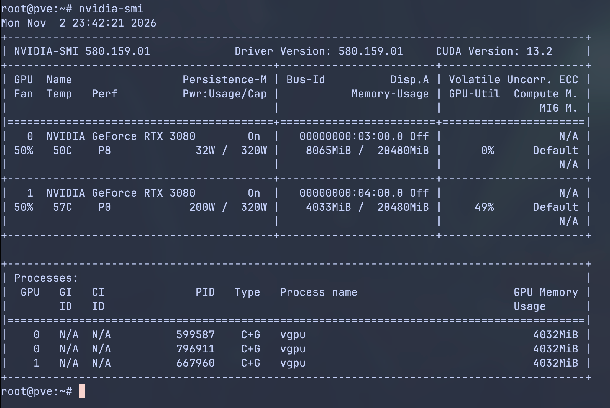
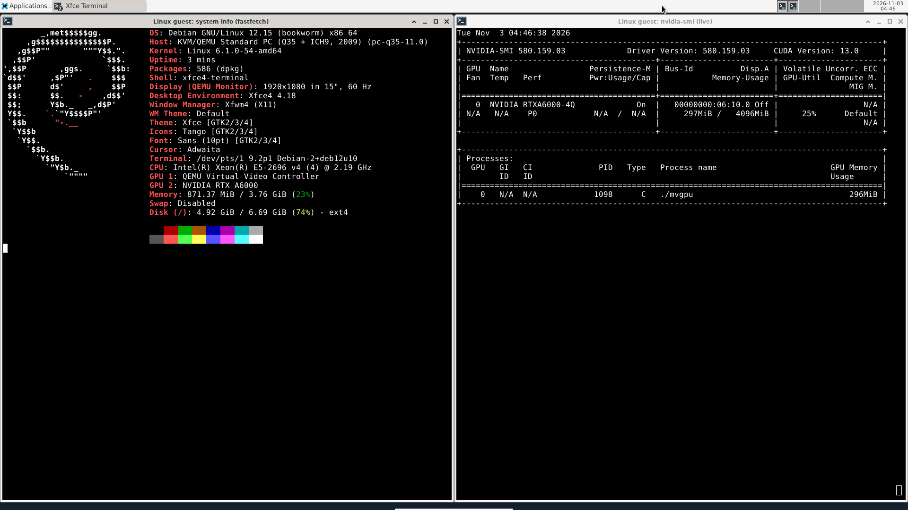
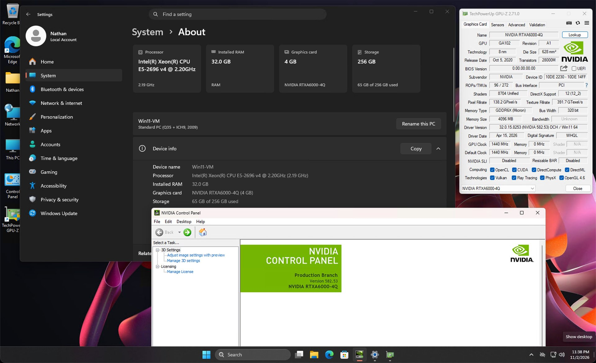

# Showcase

Screenshots of geforce-sriov in use: the host and two guests with a vGPU, and a performance
comparison of a vGPU against the host. Back to the [README](../README.md).

## Proxmox VE host

`nvidia-smi` on the Proxmox VE host lists the two physical memory-modded RTX 3080 20GB cards, at
`03:00.0` and `04:00.0`, with NVIDIA's vGPU host driver 580.159.01. Three vGPUs were running
when this was captured, each a 4 GiB vGPU (4032 MiB in the process list).

## Debian 12 guest

A real screen capture of a Debian 12 guest desktop. On the left, `fastfetch` shows the guest's
specs; on the right, a live `nvidia-smi` shows the vGPU as `NVIDIA RTXA6000-4Q` with 4096 MiB and
guest driver 580.159.03, with a CUDA test program running on it.

## Windows 11 guest

A real screen capture of a Windows 11 guest. Settings > About, the NVIDIA Control Panel (version
582.53) and GPU-Z all show the vGPU as `NVIDIA RTXA6000-4Q` with 4 GB; GPU-Z reports the device
as `10DE 2230 - 10DE 14FF`.

## Performance: vGPU VM vs host

The same PyTorch benchmark ran on one memory-modded RTX 3080 20GB in two places: on the host, using
the card's physical GPU directly, and in a VM with one 4 GiB vGPU on the same card. Nothing else
ran on the card.

| Benchmark | Host (LXC, physical GPU) | VM (vGPU) | VM / host |
|---|---|---|---|
| FP32 matmul (TFLOPS) | 20.47 | 20.54 | 1.003 |
| FP16 matmul, tensor cores (TFLOPS) | 58.35 | 58.54 | 1.003 |
| Device memory copy (GB/s) | 681.7 | 704.4 | 1.033 |

Each value is the median of three runs. A VM / host value above 1 means the VM was faster. On
matmul the vGPU in the VM performed within 1% of the host.

**Method**

- Host: an LXC container on the Proxmox VE host, running CUDA on the card's physical GPU next to
  NVIDIA's vGPU host driver 580.159.01.
- VM: one 4 GiB vGPU (`RTXA6000-4Q`) with guest driver 580.159.03.
- Identical environment: the same Debian root file system and PyTorch environment (venv), the same
  four host CPU cores pinned for both, and 8 GiB of memory.
- Workloads: a 4096 × 4096 matrix multiply in FP32 and in FP16 (tensor cores), and a 1 GiB copy
  within the GPU's memory.
- One warm-up run and three measured runs per side, each workload timed over a 15 s window. The
  input data came from a fixed seed, so both sides computed the same thing, and every run checked
  its results (matmul against a CPU reference, copies for exact equality).
- One more host run after the VM runs stayed within 0.4% of the host medians.

**Conditions**

- Nothing else ran on the card during the runs.
- SM clock about 1905 MHz in every run; power held at the card's 320 W limit on both sides; peak
  temperature 66 °C; no thermal throttling.

**The copy result**

The device memory copy was 3% faster in the VM. The card's memory clock was 2.7% higher during the
VM runs (9501 MHz against 9251 MHz on the host side), close to the same difference. Why the memory
clock differed was not tested.

**Scope**

- One card model, one host driver (580.159.01), one guest driver (580.159.03) and one vGPU profile.
- Three measured runs per side; this is no statistical claim.
- The host numbers come from the physical GPU under the vGPU host driver, not from a native GeForce
  driver.
- Running CUDA on the host needed an extra NVIDIA module and libraries. That setup is experimental
  and not part of geforce-sriov.
- Nothing is claimed about other GPUs, several VMs sharing the card, or graphics performance.

## Notes

- The guests see a vGPU profile called `RTXA6000-4Q`, not "RTX 3080". geforce-sriov presents the
  card to NVIDIA's vGPU software as the professional board (RTX A6000) whose vGPU profiles it
  uses, so the guests get that board's profile names.
- The screenshots are from the measured setup described in
  [What has been verified](../README.md#what-has-been-verified).
- The Windows screenshot was taken in a guest with its own licence setup; licensing is outside
  this project.
